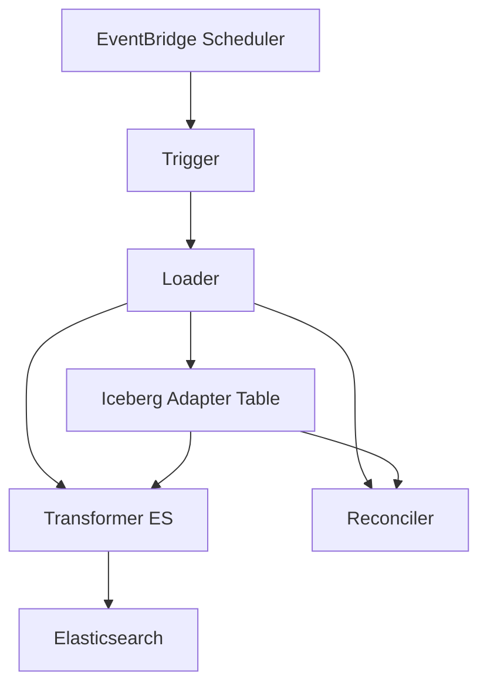
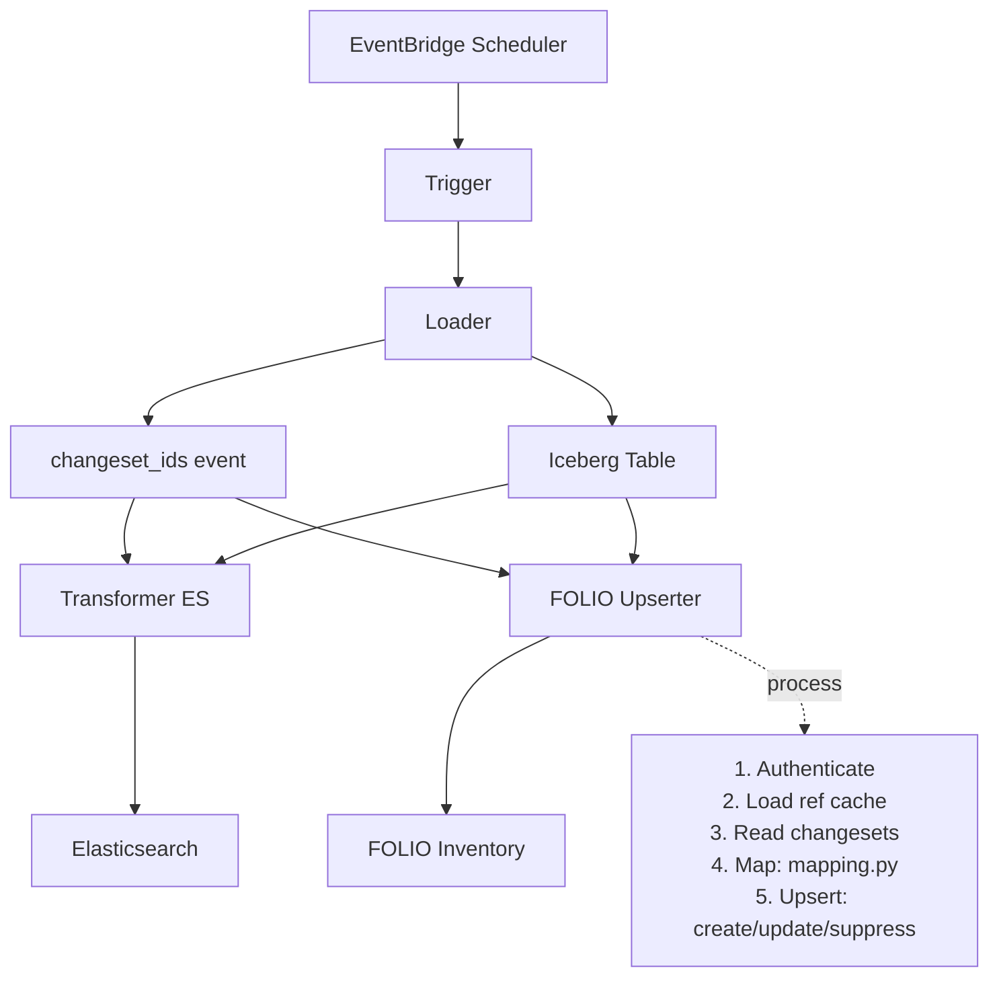
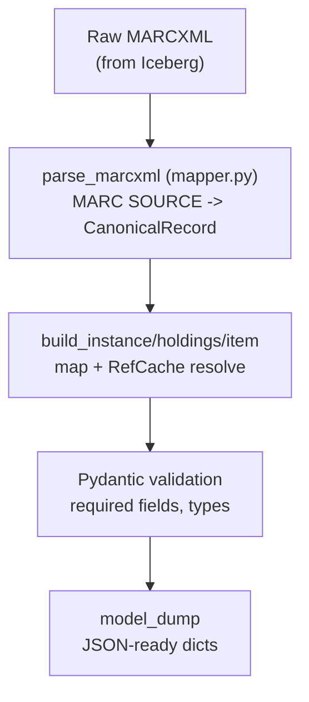
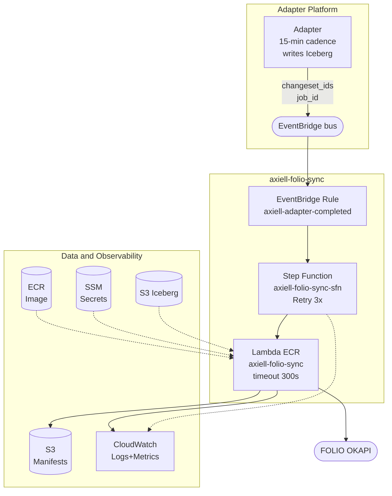
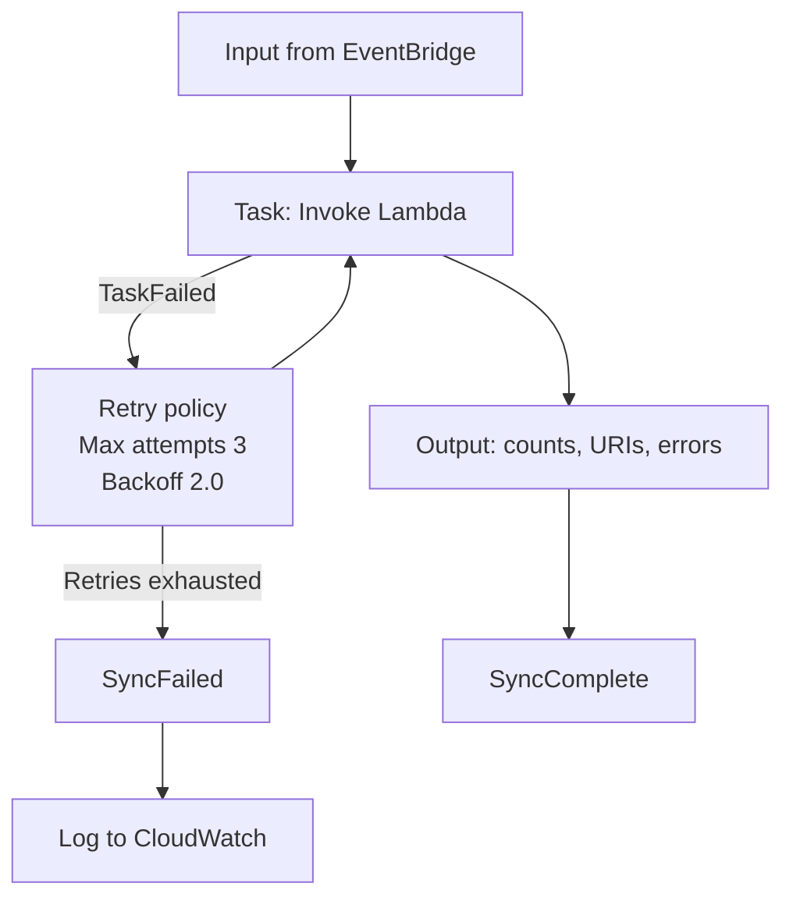

# RFC 090: CMS to LMS Sync

## Purpose

This RFC proposes an automated pipeline to synchronize data from **Axiell Collections (AxC)**, the new Content Management System (CMS), into **FOLIO**, the new Library Management System (LMS). The records from Axiell Collections need to exist in FOLIO so they can be requested and circulated in the LMS. It is designed for **idempotency** (safe to replay without duplication), **auditability** (every create / update / suppress is recorded), and **graceful error isolation** (one bad record never halts the batch).

**Last modified:** 2026-10-13T11:52:02+00:00

## Table of Contents

- [Purpose](#purpose)
- [Background](#background)
- [System Architecture](#system-architecture)
  - [Current Data Feeds for AxC and Folio Data](#current-data-feeds-for-axc-and-folio-data)
- [Proposed Change: FOLIO Item Upsert on Every Adapter Run](#proposed-change-folio-item-upsert-on-every-adapter-run)
  - [Fan-out Mechanism](#fan-out-mechanism)
- [Transformation Design](#transformation-design)
  - [Approach](#approach)
  - [Transformation Pipeline](#transformation-pipeline)
  - [Pydantic Mapping](#pydantic-mapping-mappingpy)
  - [Reference Data Cache](#reference-data-cache-ref_cachepy)
  - [Sample Field Mapping](#sample-field-mapping)
  - [FOLIO Field Mapping Reference](#folio-field-mapping-reference)
- [Change Detection Mechanism](#change-detection-mechanism)
  - [How It Works](#how-it-works)
  - [Record selection: only harvest-flagged records](#record-selection-only-harvest-flagged-records)
  - [Change Detection Signals](#change-detection-signals)
  - [How records are applied: create, update, delete](#how-records-are-applied-create-update-delete)
  - [Upsert Key Strategy (Idempotency)](#upsert-key-strategy-idempotency)
- [Proposed AWS Architecture](#proposed-aws-architecture)
  - [Key Design Considerations](#key-design-considerations)
  - [System Diagram](#system-diagram)
  - [1. EventBridge Trigger](#1-eventbridge-trigger)
  - [2. Step Function State Machine](#2-step-function-state-machine)
  - [3. Lambda Function: axiell-folio-sync](#3-lambda-function-axiell-folio-sync)
  - [4. S3 Manifest Storage](#4-s3-manifest-storage)
- [Cost Analysis](#cost-analysis)
- [Design Decisions](#design-decisions)
- [Digitisation requirements on stubs](#digitisation-requirements-on-stubs)
  - [FOLIO-assigned instance HRID](#folio-assigned-instance-hrid)
  - [Identifier set on the stub](#identifier-set-on-the-stub)
  - [Instance type per category](#instance-type-per-category)
  - [Stub marker](#stub-marker)
  - [Discovery suppression](#discovery-suppression)
- [Open Questions](#open-questions)
  - [Field Mapping from Axc to Folio Instance, Holdings and Items needs to be defined](#field-mapping-from-axc-to-folio-instance-holdings-and-items-needs-to-be-defined)
  - [Delete semantics: what should reconciler-detected deletes do in FOLIO?](#delete-semantics-what-should-reconciler-detected-deletes-do-in-folio)
  - [Watermark storage: where does the source timestamp live?](#watermark-storage-where-does-the-source-timestamp-live)
  - [Reference-data caching: when and how to cache across Lambda runs](#reference-data-caching-when-and-how-to-cache-across-lambda-runs)
  - [Manifest query mechanism: S3 Select is not an established org pattern](#manifest-query-mechanism-s3-select-is-not-an-established-org-pattern)
  - [Item creation should likely be gated on record `Level`](#item-creation-should-likely-be-gated-on-record-level)
  - [Item notes not visible on the FOLIO OAI-PMH feed](#item-notes-not-visible-on-the-folio-oai-pmh-feed)
  - [Stub identifiers and marker: decisions for Collections Information](#stub-identifiers-and-marker-decisions-for-collections-information)
  - [Axiell feed restricted to the archivecatalogue dataset](#axiell-feed-restricted-to-the-archivecatalogue-dataset)
  - [Dev tenant mismatch between the sync and the digitisation tool](#dev-tenant-mismatch-between-the-sync-and-the-digitisation-tool)


---

## Background

The Wellcome Collection library systems are undergoing migration. They currently operate as distinct layers: **CALM** (Collections Management), the Content Management System (CMS), serves as the 
collection metadata source of truth, while **Sierra**, the Library Management System (LMS), manages patron management, circulation, holds, and requesting. The CALM-to-Sierra harvester is the integration mechanism that synchronizes bibliographic metadata from CALM into Sierra for discovery and requesting workflows.

The library systems migration is replacing both layers. **CALM** is being migrated to **Axiell Collections**, and **Sierra** is being migrated to **FOLIO**. The current CALM-to-Sierra harvester will be superseded by an Axiell Collections-to-FOLIO integration pipeline. The data must be synchronized between the CMS and LMS so that the circulation of items and patron management can be carried out.

CALM-sourced data in Sierra is not being migrated to FOLIO. Therefore, AxC data must be synced to FOLIO to enable requesting and circulation workflows for items that were not included in the initial FOLIO migration. Library staff rely on FOLIO for real-time item availability and location data. Axiell-to-FOLIO sync is a core data pipeline for the new catalogue system and must be reliable, auditable, and manually recoverable.

## System Architecture

### Current Data Feeds for AxC and Folio Data

**Axiell Collections (AxC)** is the source: the Axiell Adapter Platform harvests AxC over
OAI-PMH every 15 minutes and writes each record as raw MARCXML into a single Apache
Iceberg table on S3, emitting on every run a *changeset*, the records created,
modified, or deleted in that window, identified by `changeset_id`. **FOLIO** is the
new system of record for library management (instances, holdings, items, patrons)
and also exposes its own OAI-PMH feed every 15 minutes.

**Volume:** 10–500 records per changeset, ~1,000 records/day across ~80 syncs.

#### Adapter pipeline



| Stage | Role |
|-------|------|
| Trigger | Compute the next harvest window from WindowStore history |
| Loader | Harvest OAI-PMH records in the window, write raw MARCXML to Iceberg, emit `changeset_ids` |
| Transformer | Read changesets from Iceberg, parse MARCXML (pymarc) into a SourceWork, index to Elasticsearch |
| Reconciler | Track GUID→ID mapping changes; emit DeletedSourceWork for superseded identifiers |

#### Key characteristics

The Axiell adapter harvests over OAI-PMH using the `oai_marcxml` metadata prefix and the `collect` OAI set, authenticating with a custom `Token` header rather than the standard `Authorization` header. Record identity comes from the `axiell-guid` extracted from MARC `001`, while visibility is controlled by the `InvisibleSourceWork` flag (MimsyWorksAreNotVisible). Harvesting runs in 15-minute windows with a 7-day lookback and a 360-minute maximum lag. All records land in a single Iceberg table per adapter (row schema described under [Change Detection](#how-it-works)).

---

## Proposed Change: FOLIO Item Upsert on Every Adapter Run

### Fan-out Mechanism



The FOLIO upserter is best understood as a **new type of transformer** in the existing catalogue pipeline architecture. The architecture already has the concept of a transformer: a step that consumes a changeset from Iceberg and writes the records into a downstream sink. The current `AxiellTransformer` transforms MARCXML into a `SourceWork` and indexes it into **Elasticsearch** (the discovery sink).

The FOLIO upserter follows the same pattern but targets a different sink, the **LMS (FOLIO)**, instead of Elasticsearch, and its write operation is an **idempotent upsert of item data** (instance → holdings → item) over the FOLIO OKAPI Inventory APIs rather than an index write. In other words: same input (`changeset_ids` over the same Iceberg table), new transformer, new destination.

So after the loader emits `changeset_ids`, the event fans out to **two** independent transformers: the existing ES transformer (`AxiellTransformer`, unchanged) writing to Elasticsearch for discovery, and the new FOLIO upserter writing to FOLIO Inventory for circulation and requesting in the LMS. Both consume the same `changeset_ids` independently, and either path can fail and retry without affecting the other, so adding the LMS sink does not put the existing discovery feed at risk.

The FOLIO upserter's internal module flow (`ref_cache` → read Iceberg → `mapping.py` → `upsert.py` → OKAPI) is detailed under [Transformation Pipeline](#transformation-pipeline) and the [Lambda execution steps](#3-lambda-function-axiell-folio-sync); its AWS deployment wiring is in the [System Diagram](#system-diagram).

---

## Transformation Design

### Approach

The upserter converts raw MARCXML from the AxC adapter into FOLIO payloads using **typed Python with Pydantic models** (`mapping.py`). The three payloads (Instance, Holdings, and Item) are Pydantic models with `extra="forbid"`, so the field-mapping rules are ordinary, reviewable Python and the payloads are typed contracts: a malformed payload (missing/ill-typed required field, typo'd key) **fails at build time, before any OKAPI call**, instead of surfacing as a FOLIO 422 mid-batch.

This replaces an earlier YAML-driven mapper (`mapping.yaml` + `YamlMapper`); see [Mapping: Pydantic Models vs. YAML Mapper](design-rationale.md#mapping-pydantic-models-vs-yaml-mapper) for the trade-off.

### Transformation Pipeline



### Pydantic Mapping (`mapping.py`)

`mapping.py` is the single home for everything that decides *what an Axiell record becomes in FOLIO*: the MARC source table, normalization tables, defaults, the hrid scheme, the typed payload contracts, and the field-by-field builders.

The flow runs in three steps. `parse_marcxml()` (in `mapper.py`) first extracts MARC fields via the `MARC_SOURCE` table (e.g. `title: 245$a`, `location_code: 852$b`, `barcode: 949$a`) into a typed `CanonicalRecord`, where MARC `001` is the Axiell GUID and the basis for every hrid. `build_instance/holdings/item()` then map that record into the `Instance`, `Holdings`, and `Item` Pydantic models, resolving reference data (location, material type, loan type, holdings source, instance type) through **RefCache** and applying defaults. Finally, Pydantic validates on construction (`extra="forbid"` rejects unknown keys) and `build_payloads()` returns `{"instance", "holdings", "item", "meta"}` as JSON-ready dicts, with `meta` carrying `source_id`, the three hrids, and `mapping_version` (used for audit, rollback, and tracing a record back to the rules that produced it).

**hrid scheme**: holdings and items carry a computed hrid, `AxC-holding-{guid}` and `AxC-item-{guid}`, which is their idempotency key. The instance hrid was `AxC-instance-{guid}` in the prototype; since the decision of 2026-10-12 it is assigned by FOLIO from the tenant's shared `in` sequence (for example `in00007289833`) and the instance is found again through a GUID to instance mapping table, see [FOLIO-assigned instance HRID](#folio-assigned-instance-hrid). `Instance.source = "FOLIO"` (FOLIO-native, no linked SRS record; see [Design Decisions](#design-decisions)).

---

### Reference Data Cache (`ref_cache.py`)

FOLIO APIs require UUIDs/IDs, but Axiell supplies human-readable names, so `RefCache` translates names → FOLIO IDs and caches them to avoid repeated API calls within a run. `RefCache.load()` runs once per invocation and fetches and indexes **six** reference sets:

- **Locations**: indexed by both code *and* name → UUID
- **Material types**: by name → UUID (e.g., "Books", "video recording")
- **Loan types**: by name → UUID (e.g., "Can Circulate", "Reference")
- **Holdings sources**: by name → UUID (e.g., "MARC")
- **Item note types**: by name → UUID (resolves the "Axiell location" note's `itemNoteTypeId`)
- **Instance types**: the resolved default type id (e.g., "text"), applied to every instance

**Resolution:** for each record the mapper looks names up against the cache (an in-memory, O(1) lookup, e.g. `ref_cache.location["Wellcome Science"]`) and embeds the resolved UUIDs directly in the payload; if a name isn't found the record fails with `MappingError` and is skipped for manual review. **Current normalisations:** material types map from AxC `Object_category` to a FOLIO material-type name (e.g. `"archives"` → `"unspecified"`, audio → `"sound recording"`); locations from an AxC hierarchical code (e.g. `"215;B11;MR;84;3;7"`) to a location UUID; loan types from AxC `OrderingCodes` (e.g. `"Archives - Requestable"`) to a loan-type UUID; instance type is typically `"text"`.

**Caching decision:** the cache is reloaded every run and **not** carried across invocations — about six reference-endpoint GETs (~1–3 s) is negligible next to the per-record upserts and needs no extra infrastructure (no DynamoDB/ElastiCache/TTL). For when this stops being the right trade-off and the scale-up progression, see [Caching Strategy](design-rationale.md#caching-strategy-reference-data-scaling-options).

---

###  Sample Field Mapping 

`CanonicalRecord` field = the attribute parsed from MARC via the `MARC_SOURCE`
table in `mapping.py`; the hrids are derived from the GUID (MARC `001`).

| MARC Source (Axiell) | `CanonicalRecord` field | FOLIO Target | Example |
|---------------------|------------------|--------------|----------|
| 001 (GUID) | `source_id` | Instance `hrid` | assigned by FOLIO, e.g. `in00007289833`; the GUID is stored on the instance as identifiers, see [Identifier set on the stub](#identifier-set-on-the-stub) |
| 001 (GUID) | `source_id` → `holdings_hrid` | Holdings `hrid` | `AxC-holding-4d8f1208-9812-4bb5-84ef-da436b22d9e2` |
| 001 (GUID) | `source_id` → `item_hrid` | Item `hrid` | `AxC-item-4d8f1208-9812-4bb5-84ef-da436b22d9e2` |
| 245$a | `title` | Instance `title` | Daniel Morley, an English Philosopher... |
| 852$b | `location_code` | Holdings `permanentLocationId` | resolved FOLIO location UUID |
| 852$c | `call_number_prefix` | Holdings `callNumberPrefix` | `Arch`, `Ref` |
| 852$h | `call_number` | Holdings `callNumber` | (optional) |
| 852$j | `shelving_order` | Holdings `shelvingOrder` | (optional) |
| 949$a | `barcode` | Item `barcode` | (optional) |
| 949$c | `material_type_code` | Item `materialType.id` | `Archives - Non-digital` |
| 949$l | `loan_type_code` | Item `permanentLoanType.id` | `Archives - Requestable` |
| 876$p | `copy_number` | Item `copyNumber` | `copy 1`, `copy 2` |
| 876$t | `volume` | Item `volume` | `v.1`, `disc 1 of 2` |
| 856$u | `electronic_access_uri` | Item `electronicAccess[].uri` | (optional) |
| 852$b | `location_code` | Item `notes[]`, type `Axiell location` | raw AxC location code: `215;B11;MR;84;3;7` |

The AxC location code is therefore written to FOLIO in two different fields: the Holdings `permanentLocationId` is set to the resolved FOLIO location UUID (for shelving/discovery and circulation), while the raw AxC location code is preserved as an item **note of type `Axiell location`** (for audit trail and historical reference). On update, the note is refreshed from the incoming `852$b`, so the FOLIO item always carries the latest AxC location code. (The note type name resolves to `itemNoteTypeId` via RefCache before the write; note that this note is not currently surfaced on the OAI-PMH feed, see [Item notes not visible on the FOLIO OAI-PMH feed](#item-notes-not-visible-on-the-folio-oai-pmh-feed).)

---

### FOLIO Field Mapping Reference

For a comprehensive and detailed mapping of all Axiell Collections fields to FOLIO Inventory API fields, see **[folio-axc-fields-mapping.md](folio-axc-fields-mapping.md)**.

That document provides the complete field-by-field mapping for Instance, Holdings, and Item entities, the transformation rules and MARC source information, the required-versus-optional fields for FOLIO, the reference-data requirements (locations, material types, loan types), and the field validation rules and edge cases.

---

## Change Detection Mechanism

The FOLIO upsert step leverages the existing Axiell adapter's OAI-PMH change detection to determine which records to sync.

### How It Works

OAI-PMH datestamp windows drive the harvest: the Axiell adapter only returns records whose `last_modified` falls within `[window_start, window_end)`. Each harvest window produces a unique `changeset_id`, and the records written to Iceberg in that window are tagged with it. Those Iceberg rows carry `namespace` (record type, e.g. "location", "item"), `id` (external identifier), `content` (the raw MARCXML payload), `changeset` (the changeset ID from the adapter), `last_modified` (the OAI datestamp), and `deleted` (`true` when OAI returns a tombstone). The FOLIO upserter then receives the `changeset_ids` and reads only those rows:

```python
changed_records = adapter_store.read_changed(changeset_ids)
```

### Record selection: only harvest-flagged records

Only AxC MARC records that have the **harvest flag set in MARC field `980 $a`** are synced to FOLIO. Before mapping, the upserter filters each changeset row on `980 $a`, and records without the flag are skipped entirely (never created, updated, or suppressed in FOLIO). The flag is the source-side switch by which Collection Information controls which Axiell records flow into the LMS, so the sync covers a curated subset rather than the whole changeset. (This selection step is not yet in the prototype, which currently processes every changeset row; it is required behaviour.)

### Change Detection Signals

| Signal | Source | Meaning |
|--------|--------|----------|
| Harvest flag (`980 $a`) | AxC MARC record | Record is opted in for FOLIO sync; absent means skip |
| Record in changeset | OAI-PMH datestamp window | Record was created or modified in source |
| `deleted=true` | OAI tombstone | Unreliable; best-effort only, not the authoritative delete signal |
| Payload hash mismatch | XSL output comparison (optional) | FOLIO-relevant fields actually changed |
| Reconciler GUID remap | Axiell reconciler step | Authoritative delete: old GUID superseded; suppress its FOLIO records |

### How records are applied: create, update, delete

Each record in a loader changeset is **new** (the first time this `id` appears in Iceberg) and is created in FOLIO, or **updated** (an existing `id` with a newer `last_modified`) and is updated in FOLIO.

**Deletes are driven by the reconciler, not the loader's `deleted=true` tombstone** (which is unreliable — the very reason the adapter has a separate reconciler step). The reconciler tracks the `collectId → guid` mapping in its own Iceberg store and, when a `collectId` is remapped, emits a `DeletedSourceWork` for the superseded GUID. Two things follow for the upserter: it consumes the **loader's** changeset, so it never sees these deletes directly, and a reconciler delete is keyed by the **old (superseded) GUID**, not the changeset row being processed.

**Suggested approach:** have the reconciler fan out a FOLIO suppression path mirroring the loader's fan-out to the upsert path (reusing the existing reconciler rather than building a parallel mapping store). On a reconciler delete, suppress the records for the old GUID (the instance resolved from the old GUID through the mapping table, then `AxC-holding-{old-guid}` and `AxC-item-{old-guid}`) and cascade to its holdings and item; the loader `deleted=true` stays a best-effort secondary signal only. The exact delete action (suppress vs remove, and cascade scope) is an open policy question, see [Delete semantics](#delete-semantics-what-should-reconciler-detected-deletes-do-in-folio).

### Upsert Key Strategy (Idempotency)

Every entity is matched against its existing FOLIO record by `hrid` (a GET before each write), then created or updated — no blind creates, which is what makes replay idempotent:

- Instance: a GUID to instance mapping table, keyed by Axiell GUID and holding the FOLIO instance UUID, the assigned hrid and the mapping version, written on create with a conditional put. When the table has no row, `GET /inventory/instances?query=(identifiers =/@value "{guid}")` finds a stub whose stored bare GUID equals the query value and repairs the row. The prototype keyed the instance on a computed `hrid==AxC-instance-{guid}`; that form is retired by the decision of 2026-10-12 (see [FOLIO-assigned instance HRID](#folio-assigned-instance-hrid)).
- Holdings: `GET /holdings-storage/holdings?query=(hrid==AxC-holding-{guid})`
- Item: `GET /inventory/items?query=(hrid==AxC-item-{guid})`

Every key is derived from the Axiell GUID (MARC 001), not the `collectId` (object number). Axiell reuses `collectId`s; keying on GUID prevents a reused id from overwriting the wrong FOLIO record.

**Behavior:** when a record is found, its mutable fields are updated while FOLIO-internal metadata is preserved; when it isn't found, a new record is created; and when required fields are missing, the record is skipped with a structured error logged. An update applies only if it passes the stale-write guard (incoming Axiell `last_modified` strictly newer than the watermark on the existing FOLIO record), so out-of-order or replayed changesets never overwrite newer state (see [Invocation Pattern](design-rationale.md#invocation-pattern-ordering--concurrency)).

**Replay safety:** upserts are idempotent by `hrid`, so processing the same changeset twice produces the same outcome, and manifest deduplication checks whether a changeset was already processed successfully before running it again.

---

## Proposed AWS Architecture

### Key Design Considerations

We propose a **Step Functions + Lambda + S3 architecture** with event-driven (asynchronous) invocation, per-record error isolation, and 90-day audit retention. This approach balances **operational visibility**, **fault resilience**, and **simplicity**.

| Aspect | Choice | Primary Benefit |
|--------|--------|-----------------|
| **Mapping** | Typed Pydantic models (`mapping.py`) | Build-time validation; fail fast before OKAPI, not as a FOLIO 422 |
| **Orchestration** | AWS Step Functions | Configurable retries + rich execution history for audit |
| **Compute** | Lambda (ECR container) | Stateless, scales to 0, integrates with Step Functions |
| **Data Storage** | S3 NDJSON manifests (90-day TTL) | Cost-efficient batch writes + queryable (download + `jq`, or optionally S3 Select) |
| **Trigger** | EventBridge on adapter completion | Event-driven (not polling); decoupled from adapter |
| **Invocation** | Async event → Step Function (`StartExecution`); Lambda runs synchronously within it | Decoupled from adapter; ordering via source-timestamp watermark + concurrency=1 |
| **Error Handling** | Per-record isolation | Batch completes even if individual records fail |

**Expected outcomes:** replay is safe without data corruption (idempotent upserts via FOLIO HRIDs); there is a complete audit trail, with every decision (create/update/suppress/skip) logged in S3 and CloudWatch; operational overhead stays low at ~$3–5/month for typical volume; and the mental model remains clear, with no eventual-consistency puzzles and ordered execution.

---

### System Diagram



### 1. EventBridge Trigger

**Rule**: `axiell-folio-sync-axiell-adapter-completed`

**Event Pattern**:
```json
{
  "source": ["axiell.adapter"],
  "detail-type": ["axiell.adapter.completed"],
  "detail": {
    "transformer_type": ["axiell"]
  }
}
```

**Event Payload** (emitted by Axiell adapter):
```json
{
  "changeset_ids": ["axiell-cs-20260622-001", "axiell-cs-20260622-002"],
  "job_id": "adapter-job-xyz-12345",
  "transformer_type": "axiell",
  "dry_run": false,
  "sample_limit": null
}
```

`dry_run` (default `false`) makes the Lambda resolve and **log** every planned create/update/suppress action and still write the manifests, but issue **no** FOLIO writes. It is the safe way to validate a changeset (or the initial backfill) before going live. `sample_limit` caps the number of records processed, for smoke-testing against dev FOLIO.

**IAM Permissions**: `states:StartExecution` on Step Function ARN

---

### 2. Step Function State Machine

**Name**: `axiell-folio-sync-sfn`  
**Type**: STANDARD

**Flow**:


**Execution History**: Stored in CloudWatch Logs (`/aws/states/axiell-folio-sync-sfn`, 30-day retention)

**IAM Role Permissions**:
- `lambda:InvokeFunction` on sync Lambda ARN
- `logs:CreateLogGroup`, `logs:CreateLogStream`, `logs:PutLogEvents` for CloudWatch

---

### 3. Lambda Function: axiell-folio-sync

**Docker Image**: ECR (`uk.ac.wellcome/axiell-folio-sync:TAG`)

**IAM & secrets (least privilege):** the Lambda's execution role needs `ssm:GetParameter` (+ KMS decrypt) for the OKAPI credential SecureString, read access to the Iceberg/S3 Tables data, `s3:PutObject` to the manifests bucket, `cloudwatch:PutMetricData`, and CloudWatch Logs write. FOLIO credentials live only in SSM as a SecureString and are never baked into the image or environment.

**Execution Steps**:

#### Step 1: Authenticate with FOLIO

Auth is delegated to the shared `folio-client` package: a `FolioClient` is built with a credentials provider that reads SSM, logs in lazily on first use, caches the token (valid 24h) for the invocation, and re-authenticates once automatically on a 401.
```
SSM Parameter Store (SecureString)
  Path: /axiell-folio-sync/okapi-creds
  Value: {"username": "service_account", "password": "..."}

FolioClient → POST /authn/login   (lazy, on first request)
  x-okapi-tenant: wellcome
  Body: credentials
  Response: x-okapi-token (valid 24h)
  → Cached for the invocation; auto re-auth once on a 401
```

#### Step 2: Scan Iceberg Changesets
```
Query S3 Tables Iceberg catalog
  Bucket: {S3_TABLE_BUCKET_ARN}
  Table: {ICEBERG_TABLE_NAME} (e.g., default.axiell_changesets)

SELECT [namespace, id, content, changeset, last_modified, deleted]
WHERE changeset IN ({changeset_ids from event})
  # row schema described under Change Detection > How It Works
```

#### Step 3: Map & Validate
```python
from axiell_folio_sync.mapping import build_payloads, MappingError
from axiell_folio_sync.ref_cache import RefCache

# Load tenant reference data once per run (locations, material/loan types, etc.).
ref_cache = RefCache(folio_get).load()

for row in iceberg_records:
    # Record selection: only records flagged for harvest (MARC 980 $a) are synced.
    # Unflagged records are skipped before mapping: no create/update/suppress.
    if not has_harvest_flag(row["content"]):   # 980 $a present
        continue
    try:
        # build_payloads() parses the MARCXML (mapper.parse_marcxml → CanonicalRecord),
        # builds the typed Pydantic Instance/Holdings/Item models with RefCache
        # resolution + defaults, and returns JSON-ready dicts. Pydantic validates on
        # construction (extra="forbid"), so a malformed record fails here, before
        # any OKAPI call, rather than as a FOLIO 422.
        mapped = build_payloads(row["content"], ref_cache, deleted=bool(row["deleted"]))
        # → {"instance": {...}, "holdings": {...}, "item": {...}, "meta": {...}}
        #   meta carries source_id, the three hrids, and mapping_version.
        payloads.append(mapped)
    except MappingError as e:
        # Capture error, continue to next record
        errors.append({
            "source_id": row['id'],
            "type": "mapping",
            "detail": str(e)
        })
        continue
```

#### Step 4: Upsert to FOLIO (Per Record)

Every entity is matched by its **hrid** (from `meta`) and created or updated (no
blind creates), which is what makes replay idempotent. On an existing record the
update is additionally gated by the **stale-write guard**: it applies only if the
incoming Axiell `last_modified` is strictly newer than the watermark on the FOLIO
record, otherwise the record is skipped (see [Invocation Pattern](design-rationale.md#invocation-pattern-ordering--concurrency)).

```
For each mapped record:
  Execute in order: Instance → Holdings → Item (each references the prior id)

  Instance:
    Resolve by hrid: GET /inventory/instances?query=(hrid=={instance_hrid})
      If exists: PUT /inventory/instances/{id}   → "update"
      Else:      POST /inventory/instances        → "create"
                 (some POSTs return 201 with an empty body → re-resolve id by hrid)

  Holdings (linked to the Instance id):
    Resolve by hrid in /holdings-storage/holdings → PUT (update) or POST (create)

  Item (linked to the Holdings id):
    Resolve by hrid in /inventory/items → PUT (update) or POST (create)
    (note types are resolved to itemNoteTypeId before the write)

  Loader tombstones (`deleted=true`) are treated as advisory only:
    • record and metric the signal for audit/debug
    • do not perform suppress/remove from this path
    • apply delete actions only from reconciler-generated delete events

Per-record error handling:
  • HTTP 4xx/5xx → captured, batch continues
  • All errors logged to CloudWatch AND accumulated in the S3 failures manifest
```

#### Step 5: Batch & Write Manifests
```python
# Success NDJSON (one record per line, 5K records per batch)
for i in range(0, len(success_results), 5000):
    batch = success_results[i:i+5000]
    ndjson_lines = [json.dumps(r) for r in batch]
    s3.put_object(
        Bucket=MANIFEST_S3_BUCKET,
        Key=f"manifests/{job_id}.ids.ndjson",
        Body="\n".join(ndjson_lines)
    )

# Error NDJSON (one error per line)
if errors:
    error_lines = [json.dumps(e) for e in errors]
    s3.put_object(
        Bucket=MANIFEST_S3_BUCKET,
        Key=f"manifests/{job_id}.ids.failures.ndjson",
        Body="\n".join(error_lines)
    )

# Metadata summary
metadata = {
    "job_id": job_id,
    "start_time": "2026-06-22T10:15:03Z",
    "end_time": "2026-06-22T10:15:45Z",
    "status": "SUCCESS|PARTIAL|FAILED",
    "counts": {
        "total": 247,
        "created": 10,
        "updated": 200,
        "suppressed": 25,
        "skipped": 12,
        "failed": 0
    },
    "success_manifest_uri": f"s3://{bucket}/manifests/{job_id}.ids.ndjson",
    "error_manifest_uri": f"s3://{bucket}/manifests/{job_id}.ids.failures.ndjson"
}
s3.put_object(
    Bucket=MANIFEST_S3_BUCKET,
    Key=f"manifests/{job_id}.manifest.json",
    Body=json.dumps(metadata, indent=2)
)

# CloudWatch Metrics
cloudwatch.put_metric_data(
    Namespace="AxiellFolioSync",
    MetricData=[
        {"MetricName": "RecordsCreated", "Value": metadata['counts']['created']},
        {"MetricName": "RecordsUpdated", "Value": metadata['counts']['updated']},
        {"MetricName": "RecordsSuppressed", "Value": metadata['counts']['suppressed']},
        {"MetricName": "RecordsSkipped", "Value": metadata['counts']['skipped']},
        {"MetricName": "RecordsFailed", "Value": metadata['counts']['failed']},
    ]
)

return metadata
```

---

### 4. S3 Manifest Storage

The NDJSON-manifest output is **the existing catalogue-pipeline pattern**: the adapter platform already writes per-job NDJSON id manifests to S3, and this step deliberately reuses that convention (one record per line, an `.ids.ndjson` success file plus a `.ids.failures.ndjson` error file and a `.manifest.json` summary per job). Adopting it keeps downstream tooling, backup/recovery, and operational query patterns consistent with the rest of the pipeline.

**Bucket**: `axiell-folio-sync-manifests-{account-id}-{region}`

**File Structure**:
```
manifests/
  - adapter-job-xyz-20260622-10-15.ids.ndjson
  - adapter-job-xyz-20260622-10-15.ids.failures.ndjson
  - adapter-job-xyz-20260622-10-15.manifest.json
  - adapter-job-xyz-20260622-10-30.ids.ndjson
  - ...
```

**Sample Success Record** (NDJSON):
```json
{
  "source_id": "location_item_123",
  "instance": {
    "action": "update",
    "id": "inst-abc-def",
    "hrid": "HRID-LOC-123"
  },
  "holdings": {
    "action": "createupdate",
    "id": "hold-xyz-uvw"
  },
  "item": {
    "action": "create",
    "id": "item-001-002"
  },
  "errors": []
}
```

**Sample Error Record** (NDJSON):
```json
{
  "source_id": "location_item_456",
  "error": "Mapping error: missing 245$a (title)",
  "detail": "Pydantic build raised MappingError before any OKAPI call",
  "type": "mapping"
}
```

**Lifecycle Policy**: 90-day expiration (auto-delete old manifests)

---

## Cost Analysis

At ~80 syncs/day the pipeline runs ~2,400 times/month, so the monthly quantities below derive from that:

| Service | Operation | Qty/mo | Rate | Cost/mo |
|---------|-----------|--------|------|---------|
| Lambda | ~2,400 invocations × ~60s × 512 MB | ~2,400 invocations | $0.0000167/GB-s | ~$1.20 |
| Step Functions | ~2,400 state transitions | ~2,400 transitions | $0.000025/transition | ~$0.06 |
| EventBridge | ~2,400 events | ~2,400 events | $1/M events | ~$0.00 |
| S3 (manifests) | ~2,400 objects written, 90-day retention | ~2,400 objects + storage | $0.005/K PUTs + $0.023/GB/mo | ~$1.50 |
| CloudWatch Logs | ~2,400 × 5 KB ≈ 12 MB/month | 12 MB ingested | $0.50/GB ingested | ~$0.20 |
| **Total** | | | | **~$3–5** |

---

## Design Decisions

The key choices are summarized in [Key Design Considerations](#key-design-considerations); the full trade-off analysis for each (alternatives weighed, why this option won) lives in **[design-rationale.md](design-rationale.md)** — covering mapping (Pydantic vs YAML), orchestration (Step Functions), reference caching, manifest storage (S3 NDJSON), ordering safety, error handling, and instance storage type.

The **ordering** and **error-handling** mechanisms are load-bearing for correctness, so they are stated as behaviour in [Step 4: Upsert to FOLIO](#step-4-upsert-to-folio-per-record) and the [Upsert Key Strategy](#upsert-key-strategy-idempotency); design-rationale.md explains *why* they take the form they do.

> **Instance storage type (decision).** This sync creates Inventory-native instances (`Instance.source = "FOLIO"`, no linked SRS record), which keeps the bibliographic fields editable through mod-inventory and keeps the PUT-based update path valid. SRS-backed instances cannot be updated through the mod-inventory API, so a mixed estate is avoided. Confirmed via the prototype: these records are updatable through mod-inventory and are received on the FOLIO adapter in the catalogue pipeline; one gap (item notes not appearing on the OAI-PMH feed) remains open, see [Item notes not visible on the FOLIO OAI-PMH feed](#item-notes-not-visible-on-the-folio-oai-pmh-feed). Full reasoning: [design-rationale.md](design-rationale.md#srs-backed-instances-and-the-update-path).

For the cost evidence behind the "~$3–5/month" figure, see [Cost Analysis](#cost-analysis).

---

## Digitisation requirements on stubs

[RFC 091](../091-digitisation-ingest-identifiers/README.md) makes the FOLIO instance HRID the preservation identifier for material digitised after the migration, and platform#6697 decided that visual material and AV are catalogued in Axiell Collections and synced to FOLIO. The stubs this sync creates are therefore the records that digital production's export tool resolves when it writes the marc.xml Goobi needs. The export path itself is described in RFC 091; this section records what the stub has to carry for it, decided on 2026-10-12 during the platform#6669 scoping. The requirements were checked against the sync code on catalogue-pipeline main (mapping version 2.6.1) and the hosted dev tenant on 2026-10-13.

### FOLIO-assigned instance HRID

The prototype set the instance `hrid` to `AxC-instance-{guid}`. That value becomes the preservation identifier the moment a stub is digitised: it is stamped into S3 keys, METS and JP2 file names and IIIF URIs, so it has to be a plain, file-name-safe value in the same shape as the HRIDs migrated instances carry. The instance therefore no longer sets `hrid`; FOLIO assigns the next value from the tenant's shared `in` sequence (prefix `in`, leading zeroes retained, eleven digits). Holdings and items keep their computed `AxC-` hrids, which nothing outside the sync reads.

Finding the instance again is done through a GUID to instance mapping table (Axiell GUID to instance UUID, assigned hrid and mapping version), written on create with a conditional put so two concurrent runs for one GUID cannot both create. When the table has no row the sync queries inventory with `identifiers =/@value "{guid}"`, keeps a hit only if its stored bare GUID equals the query value, and repairs the row. On the dev tenant that query is case-insensitive and took 0.1 to 0.4 seconds against 1,038,299 instances; `==/@value` is not supported by the module, so equality is checked in code. The reconciler cascade resolves the instance the same way. On update the existing HRID is carried through, which the current update path already does once the payload omits `hrid`.

### Identifier set on the stub

Stored identifiers are searchable in inventory whatever their type. mod-oai-pmh's `rules/rulesDefault.json` emits only built-in types in the MARC it generates for Inventory-native instances; that emission is inferred from the rules file rather than observed, because no FOLIO-native instance on the dev tenant carries an identifier yet.

| Source in the Axiell MARC | FOLIO identifier type | In generated MARC | Purpose |
|---|---|---|---|
| 001, the Axiell GUID | System control number, two entries: `(AxC)<guid>` and the bare `<guid>` | 035$a, inferred | The prefixed entry gives 035 its prefix; the bare entry is the value the export tool and the self-heal query match exactly |
| 035$a with the `(AltRefNo)` prefix, the object number | Local identifier, as today | 024, inferred | Human lookup |
| 035$a with the `(RefNo)` prefix | A tenant-defined type of its own, proposed name `Axiell reference number` | not emitted | Lookup by reference, and the process-title prefix the export tool writes into 945$a; a separate type is needed so the tool can tell the RefNo from the object number |
| 035$a with the `(Bibliographic Number)` prefix, or 907$a when it is b-number-shaped | Sierra system number, the tenant-defined type migrated instances use | not emitted | Lookup by b-number for re-digitisation, the predecessor rule in RFC 091 |

The b-number source needs care. The collect stylesheet fills 907$a from `PID_other.non-URI_ID`, which on migrated archive records is the CALM RecordID (RFC 092 counts it on 99.4 per cent of records). The b-number, where one exists, arrives as 035$a with the `(Bibliographic Number)` prefix through the `Alternative_number` template, the field RFC 092's import fills. What `PID_other` will hold for visual and AV records migrated from Sierra is not yet known and may be the b-number, which is why 907$a is accepted when it matches the b-number shape (`b`, seven digits, then a digit or `x`). The stored b-number is lowercase with any leading dot removed.

The b-number must not be stored under a built-in type. The catalogue pipeline's FOLIO transformer reads the predecessor from MARC 907, so a stub whose harvested MARC carried 907 with a b-number would inherit the Sierra bib's canonical id, and RFC 092 has the Axiell record cite the same b-number while keeping the work id inherited from CALM. Keeping the b-number out of the generated MARC keeps the two records apart.

### Instance type per category

Every stub is currently typed `text` through a single default. The instance type becomes a per-category table resolved through the reference cache: still image for visual material, two-dimensional moving image for film, performed music or spoken word for sound, text for archives. The dev tenant holds all 26 standard instance types. The type drives 336 in the generated MARC and gives the export tool leader byte 6, from which Goobi chooses the process type. FOLIO has no archival instance type, so an archive stub is `text` like a book and the export tool tells them apart through the stub marker.

### Stub marker

Stubs must be identifiable so that staff edit them only in Axiell. The `AxC-` HRID prefix was the only marker and the FOLIO-assigned HRID removes it. It is replaced by an administrative note, staff-only and not exported, saying the record is mastered in Axiell Collections, and a statistical code so stubs can be filtered in FOLIO searches and reports. The dev tenant has 16 statistical codes in four types and none marks a stub, so the code is new reference data. The export tool also depends on the marker: for an Axiell-mastered record whose instance type is `text` it sets leader byte 6 to `t`, so Goobi creates an Archive process rather than a Monograph, and the statistical code or the `(AxC)` System control number is how it recognises the record. The marker is part of the digitisation path, not only a staff convenience.

### Discovery suppression

Stubs are created with no `discoverySuppress`, and the catalogue pipeline's FOLIO adapter harvests every instance with no set filter, so each stub would appear in the public catalogue as a FOLIO work beside its Axiell work. The proposal is to create stubs with `discoverySuppress: true`. The generated MARC still reaches the adapter with 999$t set to 1, and the FOLIO work builder emits a `DeletedSourceWork` for it; both halves were observed on the dev tenant on 2026-10-13 with a suppressed migrated instance. The export tool ignores suppression, since both inventory and OAI-PMH return suppressed records on this tenant. If Collections Information do not want suppression, the pipeline needs a filter on the statistical code or the `(AxC)` 035 prefix instead, which is a pipeline change rather than a sync change. Identifiers, instance type, the administrative note and the statistical code are replaced on every update so a corrected Axiell record corrects the stub.

---

## Open Questions

### Field Mapping from Axc to Folio Instance, Holdings and Items needs to be defined

The field mapping still needs to be finalised with Collection Information; the sample file **[folio-axc-fields-mapping.md](folio-axc-fields-mapping.md)** has been shared with them for feedback. A minimum stub record also needs to be defined, and the source of data (MARC vs FOLIO) for inventory types remains open and should be tested with both options.

### Delete semantics: what should reconciler-detected deletes do in FOLIO?

Raised here for an answer, not settled. In FOLIO there are different operations: *suppress* (`discoverySuppress=true`, optionally `staffSuppress=true`) hides the record while preserving it and its links, so it is reversible and audit-friendly; *remove* (a hard `DELETE`) deletes it outright, which is irreversible, and FOLIO refuses to delete a parent that still has dependents. As a starting point we'd **suggest `discoverySuppress=true`** (preserve-and-hide), but that is a recommendation to confirm with Collection Information, not a decision. A second part of the question is whether the action **cascades** from instance → holdings → item or acts on the item only; this interacts with the [1:1-vs-multi-item question](#item-creation-should-likely-be-gated-on-record-level), since an instance shared by other items must not be suppressed or removed when one item is deleted.

Specific points to resolve with Collection Information: whether suppressed items should remain queryable by staff (i.e. whether to also set `staffSuppress`); how an item-level deletion behaves when its holdings or instance still have other dependents; whether deletion should propagate in either direction (item → holdings → instance, or the reverse); and the retention policy for suppressed records in the audit log.

### Watermark storage: where does the source timestamp live?

The stale-write guard (see [Invocation Pattern](design-rationale.md#invocation-pattern-ordering--concurrency)) needs the Axiell `last_modified` of the last applied change stored **on the FOLIO record** so the next write can compare against it. FOLIO does not offer an obvious home for this: `_version` is mod-inventory's optimistic-locking counter (not a source timestamp), and `discoverySuppress` is a boolean. Candidates are an **administrative note**, a **custom property**, or a dedicated field, each with trade-offs for visibility, OAI-PMH leakage, and whether it survives a quickMARC/SRS round-trip. The storage location needs to be decided (and confirmed not to pollute the catalogue feed) before the guard can be implemented.

### Reference-data caching: when and how to cache across Lambda runs

Today `RefCache` reloads all six reference sets on every invocation, which is the right trade-off at current volume (see [Reference Data Cache](#reference-data-cache-ref_cachepy)). The open question is what happens if the reference set grows substantially. We would need to decide the size or load-latency threshold at which caching across runs is worth the added complexity. Staleness is unlikely to be the blocker: the reference data changes rarely, so a long TTL would seldom be stale, and a reload-on-miss fallback would keep a newly-added code from failing as a `MappingError`. So the question is mostly about whether the saved reload justifies the extra infrastructure. We would also need to pick a tier when we get there: the progression runs from a warm-singleton with reload-on-miss, to an S3 snapshot rebuilt by a scheduled refresher, to DynamoDB, and only then to ElastiCache (see [Caching Strategy: Reference Data Scaling Options](design-rationale.md#caching-strategy-reference-data-scaling-options) for the trade-offs).

### Manifest query mechanism: S3 Select is not an established org pattern

The design mentions **S3 Select** as a convenient way to query the NDJSON manifests (e.g. list failed records), but S3 Select is **not used anywhere else in the org today**, so adopting it would be a new pattern to learn, permission, and maintain. The design deliberately does not depend on it: the manifests are plain NDJSON, so the same questions can be answered by downloading the object and using `jq`/`grep`, or by pointing Athena at the manifests prefix. Open question: do we standardise on a query mechanism (plain download + local tooling, S3 Select, or Athena/Glue), and is it worth introducing S3 Select solely for this pipeline? Until decided, treat S3 Select as optional and lead with download + `jq` for operational investigation.

### Item creation should likely be gated on record `Level`

The legacy CALM→Sierra transform (`docs/discovery/CalmInnopac.xsl`) only attaches an item (its MARC `949`) when the record's `Level` is "Item"; higher levels (Collection, Series, File, …) get a bib record with no item. The current prototype instead builds an instance, holdings, **and** item for every record, regardless of level. We need to confirm with Collection Information whether the AxC → FOLIO mapping should branch the same way (item only for Item-level records, instance/holdings-only above that) and, if so, how `Level` arrives in the harvested MARCXML so the mapper can read it. This also backs the **1:1 instance-to-item** assumption: `CalmInnopac.xsl` produces at most one item per record (no `for-each` over copies/locations, and a multi-location attempt was left disabled), so multiple items per record is not established behaviour and would be a deliberate future extension rather than something to match on day one.

### Item notes not visible on the FOLIO OAI-PMH feed

Confirmed via the prototype: FOLIO-native instances (`source = "FOLIO"`) created by this sync **can** be updated through mod-inventory, and the records **are** received on the FOLIO adapter in the catalogue pipeline (so the storage-type and catalogue-feed concerns are largely settled for Inventory-native records). One issue remains open: the item **notes list does not appear on the OAI-PMH feed** (`marc21_withholdings`). The records otherwise come through, but the notes we set (for example the `Axiell location` note) are missing from the harvested output. This needs further investigation, likely into how mod-oai-pmh renders Inventory item notes in the MARC output and whether a note type, `staffOnly`, or suppression setting hides them.

### Stub identifiers and marker: decisions for Collections Information

The requirements in [Digitisation requirements on stubs](#digitisation-requirements-on-stubs) leave these open:

1. The `655$a` vocabulary for migrated visual and AV records, and whether `351$c` will be `ITEM` for them.
2. Whether stubs are discovery-suppressed, or the public catalogue filters them another way.
3. The wording of the administrative note and the statistical code used as the stub marker.
4. Whether stubs may draw from the shared `in` HRID sequence, whose settings EBSCO manage, or need a prefix of their own. The export tool and Goobi accept either, but it must be settled before anything is stamped into file names or storage paths.
5. The loan type source, carried over from catalogue-pipeline PR 3746.
6. Whether museum and film records should reach the public catalogue through the Axiell transformer as soon as they enter the feed, or be held back.
7. What `PID_other.non-URI_ID`, and so 907$a, will carry for visual and AV records migrated from Sierra, and whether their b-numbers will be loaded as `(Bibliographic Number)` alternative numbers as RFC 092 does for archives.
8. The name of the tenant-defined identifier type for the Axiell RefNo, which EBSCO or Collections Information add as reference data.

### Axiell feed restricted to the archivecatalogue dataset

Verified on the production Axiell endpoint on 2026-10-13: the OAI `collect` set is restricted by a search statement `dataset=archivecatalogue` in `adlibweb.xml`, applied by Axiell on 2026-07-28 at our request (platform#6460). Visual records are destined for the `museum` dataset and AV for `film`; on that date museum held 11,008 records and film none. Nothing in those datasets reaches the adapter, so nothing reaches the sync. Before any visual or AV stub can exist Axiell widens the statement to `dataset=archivecatalogue,film,museum` and recycles the application pool, we run a full reharvest because the change does not touch record modification dates, the museum and film record shapes are checked against the collect stylesheet, and Collections Information agree whether those records may reach the public catalogue at the same time, since the adapter feeds both. The migrations are estimated at January 2027 for visual and March 2027 for AV (Nicola Cook, 2026-08-27, unconfirmed), so the sync changes can be built and tested on archive records first.

### Dev tenant mismatch between the sync and the digitisation tool

The deployed sync Lambda runs with `FOLIO_TARGET=dev` against a FOLIO at a private VPC address, tenant `diku`. The export tool and the verification in this RFC use the EBSCO-hosted dev tenant `fs00001190`, which holds the migrated Sierra data, mod-oai-pmh and the OAI edge, and no synced stubs. End-to-end testing of a stub through the export tool needs both on one tenant. The proposal is a second sync target pointing at `fs00001190` with its own SSM credential, used for a bounded dry run and then a small live run, rather than moving the tool to `diku`, which lacks the reference data and the OAI edge. Whether EBSCO accept stubs being written to `fs00001190`, and what cleanup they expect, is open.
