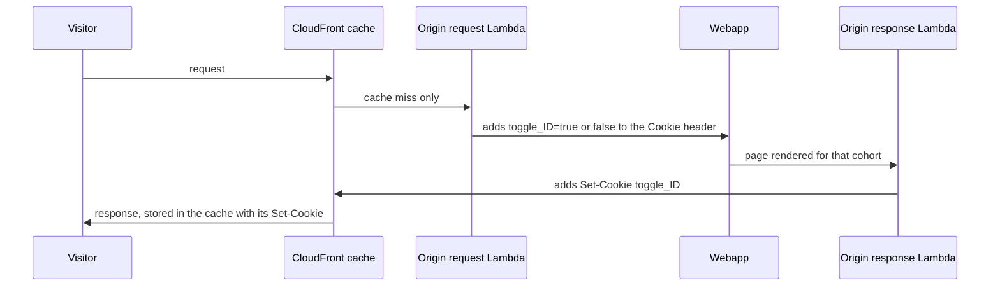
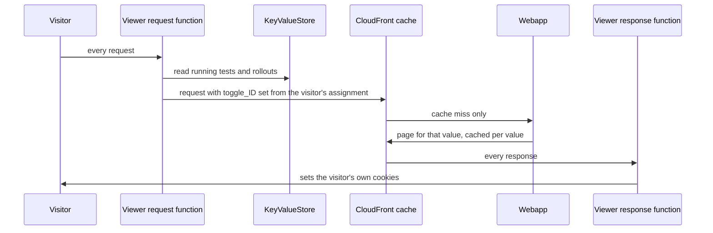

# RFC 094: A/B tests and percentage rollouts on wellcomecollection.org

## Purpose

This RFC proposes how A/B tests should work on wellcomecollection.org, and how releasing a feature to a percentage of visitors can use the same underlying assignment. It replaces the A/B test assignment in our Lambda@Edge with a CloudFront Function that runs before the cache lookup, so that each visitor is assigned once and keeps their assignment. It treats an A/B test and a rollout as two different things with different rules, built on that one piece of plumbing.

**Last modified:** 2026-11-16T14:10:00+00:00

**Related issues:**

- [wellcomecollection.org#13836](https://github.com/wellcomecollection/wellcomecollection.org/issues/13836): rebuild the A/B test mechanism so one system handles A/B tests and rollouts. This RFC is a proposal for that ticket, and its spike answers the questions the ticket asks.
- [wellcomecollection.org#13785](https://github.com/wellcomecollection/wellcomecollection.org/issues/13785): release features to a percentage of visitors for beta testing. The decisions behind it are summarised in [#13786](https://github.com/wellcomecollection/wellcomecollection.org/issues/13786#issuecomment-6820850777).
- [wellcomecollection.org#13837](https://github.com/wellcomecollection/wellcomecollection.org/issues/13837) and [#13821](https://github.com/wellcomecollection/wellcomecollection.org/issues/13821): showing rollouts in the dashboard, and telling visitors they are in a beta. Both depend on this mechanism.

## Background

### An A/B test and a rollout are different things

We have two reasons to give some visitors a different version of the site, and they are easy to run together because both involve a percentage.

An A/B test is a measurement. We do not yet know whether a change is better, so we show it to a fixed share of visitors, keep a comparable control group, and decide what to do from the result.

A rollout is a release. We have already decided to ship a feature, and we give it to a growing share of visitors so that a problem affects few people and can be withdrawn quickly.

| | A/B test | Rollout |
| --- | --- | --- |
| The question | Is the variant better than what we have? | Is it safe to release what we have decided to ship? |
| Decision to ship | Not made yet | Already made |
| Percentages | Set in advance from the sample the test needs, then left alone | Raised in steps as confidence grows |
| What changes a percentage | Almost nothing, by design | Operational health: errors, performance, feedback |
| Control group | Required, recorded and comparable | Not needed |
| What the visitor is told | Nothing, so that behaviour is not affected | May be told they are seeing a beta |
| How it ends | A recorded decision: ship, drop, or revise and test again | The feature becomes public and the flag is retired |

A test is not a rollout that has not finished yet. Turning a test's percentage up until everyone has the variant skips the decision the test exists to inform, and changing its percentages while it runs damages the measurement (see [Percentages are fixed](#percentages-are-fixed)). When a test ends with a decision to ship, releasing the winner is a separate step, and it may or may not use a rollout.

What the two share is plumbing. Both need a stable, independent position for each visitor on each toggle, placed in the cache key before a page is served. [#13836](https://github.com/wellcomecollection/wellcomecollection.org/issues/13836) asks for one system for both, and this RFC proposes one assignment mechanism with two separate things built on it. Our focus is the A/B test, because measurement is where the current mechanism fails. Rollouts are specified here as far as the shared mechanism requires.

### How A/B tests work today

A test is defined twice: in [`cache/edge_lambdas/src/toggler.ts`](https://github.com/wellcomecollection/wellcomecollection.org/blob/main/cache/edge_lambdas/src/toggler.ts), which assigns visitors, and in [`toggles/webapp/toggles.ts`](https://github.com/wellcomecollection/wellcomecollection.org/blob/main/toggles/webapp/toggles.ts), which tells the webapp and the dashboard that the test exists.



The webapp reads the `toggle_ID` cookie and renders the matching version. It also writes the visitor's test cohorts into the GA dataLayer, as the `toggles` value, on each full page load.

Three tests have used this since 2023. None is running now.

### Problems with the current design

The Lambda runs at the origin-request event, which CloudFront only fires on a cache miss, after it has computed the cache key. Several problems follow from that.

1. Cohorts are assigned per cache miss. When a visitor without the cookie requests a page that is already cached, they receive the cached page, which was rendered for whichever cohort the earlier visitor was given. CloudFront also stores `Set-Cookie` headers with cached responses and replays them, so the visitor is given that same cohort's cookie. We confirmed the replay on our staging site. On a busy page this means one random draw per cache lifetime (an hour) per edge location. Visitors are not assigned independently, which is the assumption any analysis of the results depends on. [#13836](https://github.com/wellcomecollection/wellcomecollection.org/issues/13836) suspected this from the AWS documentation, and it is now tested.
2. The `range` setting, which is meant to limit a test to a share of traffic, is drawn again on every uncached request from a visitor who has no cookie yet. A visitor who is left out on one page can be enrolled on the next. A test set to 10% enrols most visitors who view enough pages.
3. Client-side navigation is never assigned. The `/_next/data/*` cache behaviour has no Lambda attached, so a visitor who arrives on one page and follows links to a page under test sees the default version and is not recorded as being in the test.
4. The cookie is a session cookie for one host. Returning visitors are assigned again and can change cohort.
5. When the Lambda sets its cookie it replaces any `Set-Cookie` header the webapp sent.
6. Each running test multiplies the number of cached copies of every page on the site, including pages the test does not affect, because `toggle_*` cookies are part of the cache key everywhere.
7. Adding or removing a test takes two definitions, a Lambda build, two Terraform applies and a manual version bump.

The first three mean that results from past tests cannot be treated as coming from a randomised sample of visitors. A rollout built on this would have the same faults: "10% of visitors" would not be 10%, and a visitor could move in and out.

## Requirements

For the shared assignment mechanism:

1. A visitor has a stable position for each toggle, decided independently of other visitors, of other toggles and of the cache, and kept across visits.
2. It works for client-side navigation as well as full page loads.
3. A personal cookie, set from the dashboard or a `?toggle=` link, overrides it in both directions.
4. Percentages are changed without a code deploy, and every change is recorded with a timestamp and kept.
5. Pages stay cacheable, and a toggle does not reduce the cache hit rate on pages it does not affect.

For A/B tests:

6. A test cannot start without a plan: a hypothesis, a primary metric, a planned sample or duration, and success criteria.
7. A test's exposure (the share of visitors in the test) and split (the share of those who get the variant) are set in the plan and fixed while it measures. A change is an exception that needs a recorded reason and starts a new analysis period.
8. Exposure to a test is recorded in Google Analytics for visitors who have consented to analytics, with enough detail to analyse each period separately. We accept that visitors who have not consented are not measured.
9. A test ends with a recorded decision.

For rollouts:

10. A feature flag, or a phase of a phased flag, can be released to a percentage of visitors. Visitors outside see the public value.
11. Raising the percentage only adds visitors. Nobody who was in is removed.
12. A rollout can be withdrawn quickly.

Requirements 1, 3, 10 and 11 restate acceptance criteria from [#13785](https://github.com/wellcomecollection/wellcomecollection.org/issues/13785). [Fit with the beta testing tickets](#fit-with-the-beta-testing-tickets) goes through that ticket and the others in its epic one criterion at a time.

## Proposal

### Overview

Assignment moves to a CloudFront Function on the viewer-request event. Viewer-request runs on every request before CloudFront looks in its cache, so the function can decide what the visitor should get and write it onto the request as the `toggle_ID` cookie that the cache key and the webapp already use. A second function on viewer-response stores the visitor's assignments in their browser. The list of running tests and rollouts, with their current percentages, lives in a CloudFront KeyValueStore that the function reads on each request. This part is shared. What a test is and what a rollout is are described separately after it.



The webapp keeps resolving toggles from `toggle_ID` cookies as it does now, and needs no change to do so. The existing toggler code is removed from the Lambda@Edge, and the origin-response Lambda, which does nothing else, is detached. The redirector stays where it is.

We tested this arrangement on a temporary CloudFront distribution in front of our staging site. The results are under [Evidence from the spike](#evidence-from-the-spike).

### The shared assignment mechanism

Everything in this section is the same for tests and rollouts.

The function works from a list of running assignments in the KeyValueStore. Each one names a toggle, the share of visitors who are in, and the value they get.

The function keeps two cookies of its own on the visitor's browser. Neither is part of the cache key and neither is sent to the webapp. Both are set for `.wellcomecollection.org`, so the dashboard can read them, and both last six months from the visitor's most recent visit.

| Cookie | Contents | Purpose |
| --- | --- | --- |
| `wc_ab_bucket` | A random whole number from 0 to 9999 | A stable input for assignment that is shared by many visitors, so it does not identify one |
| `wc_ab` | One entry per toggle the visitor has been assigned: toggle id, version, and value | The record of what the visitor was given and under which percentages |

For each running assignment, on each request:

1. If the request carries a personal `toggle_ID` cookie, leave it alone and stop.
2. If the visitor has an entry for the toggle in `wc_ab`, use it.
3. Otherwise hash the toggle id together with the visitor's bucket number, and take two numbers from the hash. The first decides whether the visitor is in. For a test, the second decides which version they get. Including the toggle id in the hash gives each toggle its own audience.
4. If the visitor is in, add an entry to `wc_ab` recording the value and the version in force.
5. Set `toggle_ID` on the request to the visitor's value, or remove it for visitors who are not in.

A visitor who is not in has no entry. Because the hash is deterministic they stay out for as long as the percentage is unchanged, and they are considered again if it rises.

Each test and each rollout has a version number that increases by one whenever its percentages change. A change takes about a minute to reach visitors. In our test the new value first appeared 34 seconds after the write, and for roughly 20 seconds after that requests saw old and new values interleaved. Each assignment records the version it was made under, so the interleaving does not make any visitor's record ambiguous.

#### Personal cookies

Staff and testers put themselves on a chosen value today with a `toggle_ID` cookie, set from the toggles dashboard or a `?toggle=` link. That keeps working and takes priority. If the request carries a `toggle_ID` cookie for a toggle with a running assignment, the function leaves it in place and does not make or record an assignment. This holds in both directions: `true` or a phase id puts someone in, and `off` keeps them out of a rollout they would otherwise be in. A value of `false` on a feature flag means no preference today, and the function treats it as no cookie.

Anyone can set that cookie, as they can today. It only selects between cached versions of a page that exist anyway.

#### Limiting an assignment to the pages it affects

A test or rollout can list the path prefixes it applies to. Assignment is the same on every page, but the function only adds `toggle_ID` to requests for those paths. Pages outside them keep a single cached copy. For `/_next/data/BUILD/path.json` requests the function compares the page path inside the URL.

### A/B tests

#### Definition and plan

A test is defined in a new file, `toggles/webapp/tests.ts`. This replaces the entry in `toggler.ts`, its `when` function, and the `tests` list in `toggles.ts`. A definition has:

| Field | Purpose |
| --- | --- |
| `id`, `title`, `description` | As today |
| `hypothesis` | What we expect the variant to change, and why |
| `primaryMetric` | The one measure the decision rests on |
| `plannedSample` or `plannedDuration` | How many exposed visitors per version, or how long, the test needs before it is read |
| `successCriteria` | What result leads to which decision |
| `exposure`, `split` | The percentage of visitors in the test, and the percentage of those who get the variant |
| `paths` | The pages the test affects |
| `documentationLink`, `dashboardLink` | Optional links to the fuller test plan and to the report where results are read |

The plan fields are required. A test without them does not type-check, and `yarn deploy` will not publish it. They are short text, and the point is that they are written down, reviewed in the pull request that adds the test, and published with it before any visitor is enrolled.

Tests are two-way, with a control and a variant, which is what `useABTest` and the `toggle_ID` cookie already express. Tests with more than two versions are not part of this proposal.

#### Percentages are fixed

A test's exposure and split come from its definition and are meant to stay as they are while it measures.

The reason is statistical. If the split changes part-way, visitors enrolled before and after were divided in different proportions, and pooling them can give a misleading result, including the wrong sign (Simpson's paradox). If exposure is raised because the result so far is not significant, that is a form of looking early and acting on what you see, which raises the rate of false positives well above the level the test was designed for (Johari and others, "Peeking at A/B Tests", [summarised here](https://blog.acolyer.org/2017/09/28/peeking-at-ab-tests-continuous-monitoring-without-pain/)). The remedy for a test that needs more data is to have planned for it: a larger sample, a longer duration, or an extension rule written into the success criteria before the test starts.

Two changes are allowed.

The first is a safety ramp at the start. A test can begin at a lower exposure than planned for a short period, to catch a broken variant while few visitors have it, and then move to its planned exposure. This is standard practice (LinkedIn's [SQR paper](https://arxiv.org/abs/1801.08532) describes short early ramps before the ramp that does the measuring). The split is the same throughout.

The second is an exceptional change, for example lowering exposure because the variant is hurting a page that matters. It needs a reason, which is recorded, and it starts a new analysis period.

Each version of a test's percentages is an analysis period. The exposure event carries the version, so the analyst can read each period separately and decide whether periods with the same split can be pooled. Visitors keep the cohort they were first given across periods, because the stored assignment is used first.

#### Commands

```
yarn startTest --id=newTags [--ramp=5]
yarn rampTest --id=newTags
yarn changeTest --id=newTags --exposure=10 --reason="Variant slows the works page"
yarn finishTest --id=newTags --decision=ship
```

`startTest` starts the test at its planned percentages, or at a lower safety exposure if `--ramp` is given. `rampTest` moves a test from its safety exposure to the planned one. `changeTest` is the exception and will not run without a reason. `finishTest` will not run without a decision.

Each command reads the published `tests.json`, records the change with a timestamp, writes `tests.json`, and writes the running tests to the KeyValueStore. If a later write fails, running the command again repairs it. A developer runs these. There is no dashboard control.

`tests.json` is published next to `toggles.json` on `toggles.wellcomecollection.org`. For each test it holds the definition and plan, the state, the current percentages and version, the history of changes with their reasons, and the decision. It is the durable record of a test. It is public, so entries do not include who made a change. `toggles.json` keeps only the ids and titles of tests that have not finished, which is what the webapp needs to accept their cookies.

#### The life of a test

| State | How it gets there | What visitors get | Personal cookie |
| --- | --- | --- | --- |
| Ready | The definition is merged and `yarn deploy` is run | Nobody is enrolled | Works |
| Running | `yarn startTest` | Enrolled according to the plan | Works |
| Finished | `yarn finishTest` | Nobody is in the test | Stops working |

A ready test is listed in `toggles.json`, so the webapp accepts its cookie and the variant can be checked on staging and production before any visitor is enrolled.

Finishing records the decision and the time, removes the test from the KeyValueStore, and removes it from the list in `toggles.json`. About a minute later the function stops setting `toggle_ID` for it, so every visitor gets the control version, and the function drops the test's entry from each visitor's `wc_ab` cookie on their next request. Because it takes effect that quickly and needs no deploy, finishing with a decision of `drop` is also how a test is stopped in a hurry if a variant turns out to be broken.

The decision is one of three.

- `ship`: the variant is the version we are keeping. See [From a test to a release](#from-a-test-to-a-release).
- `drop`: the control stays, and the variant's code is removed.
- `revise`: the idea is changed and tested again, as a new test with a new id.

A finished test stays finished. Its record remains in `tests.json`, and its definition and any code that reads it can then be removed. A new id for a revised test keeps the two sets of assignments and results apart.

`yarn deploy` protects these states. It refuses to run if the definition of a ready or running test has been deleted from `tests.ts`, with a message saying to finish the test first.

#### Reporting to Google Analytics

Exposure to a test is reported with a new event that follows [Google's convention for experiment integrations](https://developers.google.com/analytics/devguides/collection/ga4/integration): an `experience_impression` event with an `exp_variant_string` parameter.

- The event is sent when a component that depends on a test renders, through a small hook that wraps `useABTest`. A visitor who is assigned to a test but never reaches the page it changes is not counted as exposed.
- The value has the form `wc-TESTID.vVERSION-COHORT`, for example `wc-newTags.v2-variant`, which fits GA's 100-character limit on parameter values. The version identifies the analysis period.
- The hook reads the version from the `wc_ab` cookie in the browser. The version is not rendered into the page, because the cached page is shared by visitors assigned under different versions.
- The hook does not send the event when the visitor's value came from a personal cookie, so staff previews are left out of results.

The event needs a GTM tag and a custom dimension for `exp_variant_string`, which is the analyst's to set up. Google's guide describes audiences per variant, created through the Admin API by third-party tools. We would not be doing that automatically, and a custom dimension analysed in Explorations or BigQuery may be all we need.

The existing `toggles` value in the dataLayer continues to list the tests a visitor is in, so current report filters keep working.

### Rollouts

A rollout applies to a feature flag or to one phase of a phased flag. It has a single percentage and no split: everyone in the rollout gets the feature, and everyone outside gets the public value.

A rollout is not defined in code. It is runtime state on a flag in `toggles.json`, in the same way a flag's public value is today, with a short history of when the percentage changed.

```
yarn setRollout --id=brandUpdate --percent=10
yarn setRollout --id=imageSidebarPhases --phase=phase3 --percent=25
yarn completeRollout --id=brandUpdate
yarn cancelRollout --id=brandUpdate
```

- `setRollout` starts a rollout or changes its percentage. Raising it adds visitors and removes nobody. A flag can have one rollout at a time.
- `completeRollout` makes the rolled-out value the public default and then ends the rollout. Visitors in the rollout see no change, and everyone else gets the feature.
- `cancelRollout` ends the rollout without changing the public value. About a minute later every visitor is back on the public value. This is the quick way to withdraw a feature that is causing problems.

The percentage is expected to rise in steps on operational grounds, and there is no restriction on changing it. That freedom is the difference from a test.

For a phased flag, a rollout of one phase leaves the public phase as it is. Visitors outside see the public phase, or nothing if no phase is public yet.

Visitors in a rollout appear in the existing `toggles` dataLayer value by the flag's id, as [#13785](https://github.com/wellcomecollection/wellcomecollection.org/issues/13785) asks. The webapp can add this as it renders, because the page is specific to the visitor's value. The deploy check that keeps that value within GA's 100-character limit is extended to count rollouts.

That label is for filtering reports and watching for problems. It does not make a rollout a measurement. The visitors in a rollout may be shown a beta label ([#13821](https://github.com/wellcomecollection/wellcomecollection.org/issues/13821)), they were added at different times as the percentage rose, and under the consent position below they are drawn only from visitors who accepted analytics cookies, while everyone else includes those who did not. A difference between the two groups could come from any of those. If we want to know whether a feature is better, that is a test, run before the rollout.

### From a test to a release

When a test finishes with a decision to ship, the variant has to become what everyone gets. There are two routes, and both are a code change, because a test's variant is read with `useABTest` and a rollout acts on a feature flag.

- Make the variant unconditional and remove the test's code. This releases it to everyone at once. It should be deployed before the test is finished, so that visitors who had the variant do not go back to the control for a while.
- Put the variant behind a feature flag and roll it out. This is for a change that carries enough operational risk to want a gradual release.

The second route means a visitor who had the variant in the test may be outside the rollout at first. I think that is acceptable for the size of change we test, and it is the cost of keeping tests and flags as separate things. [Flags with rules](#flags-with-rules) under Alternatives describes the design that would remove it.

### Consent

A visitor is only given an assignment once they have accepted analytics cookies. The function reads the consent cookie that our consent banner sets, which is already part of the cache key. Visitors who have not consented get the public version of everything and are given neither `wc_ab_bucket` nor `wc_ab`. If consent is withdrawn, the viewer-response function removes both cookies. A visitor's first page view usually happens before they have answered the banner, so they are assigned from their next request after accepting.

The purpose of the cookie differs between the two, and so does the argument about consent.

For A/B tests, enrolling only consenting visitors is the cautious reading. The ICO's [guidance on storage and access technologies](https://ico.org.uk/for-organisations/direct-marketing-and-privacy-and-electronic-communications/guidance-on-the-use-of-storage-and-access-technologies/what-are-the-exceptions/) lists A/B testing as an example likely to meet the statistical purposes exception, which would allow enrolling visitors without consent provided they are told and can object. That exception has conditions, and the guidance does not discuss a cookie that keeps a visitor's cohort. Enrolling only consenting visitors costs a test nothing in measurement, since they are the only visitors GA records.

For rollouts, the cookie decides which version of the site someone is given, and I do not think the statistical purposes exception fits that. Under this position a rollout "to 25%" reaches 25% of visitors who have accepted analytics cookies, which is a smaller share of all visitors, and a rollout cannot reach everyone by its percentage alone. That is why `completeRollout` changes the public default. Whether a rollout cookie can be set without consent on some other basis needs advice from whoever advises us on data protection, and the beta testing plan has not considered it.

Kiosk devices are treated as consenting by the webapp. I propose excluding them from tests and rollouts, because they show a different version of the site to a different audience.

### Failure handling

A CloudFront Function that throws returns a 503 to the visitor, and CloudFront will publish a function that contains a syntax error. We met both while building the spike. So:

- The handler catches every error and returns the request unchanged, which means the visitor gets the public version.
- A missing or unreadable KeyValueStore entry is treated as nothing running.
- CI runs `aws cloudfront test-function` against the new code with sample events, including a request with no cookies and one with malformed cookies, and does not publish if any fails.
- The function is deployed to the staging distribution first, as the Lambda is now.

[#13836](https://github.com/wellcomecollection/wellcomecollection.org/issues/13836) asks whether we want an alarm on the cache hit rate. I think we do, alongside an alarm on function errors, since both are ways this mechanism could quietly cost us.

### Dashboard

A/B tests get their own page next to the toggles page. For each test it shows the plan (hypothesis, primary metric, planned sample or duration, success criteria), the state, the current percentages, each analysis period with its dates and any reason for a change, the decision once there is one, and the links to its documentation and results. It is read from `tests.json` and is read-only.

The "A/B tests" group on the toggles page today is a personal control: it lets you count yourself in or out of a test in your own browser. That stays there as a short row per test that links to the new page.

Rollouts are shown on the toggles page, on the flag they belong to, as [#13837](https://github.com/wellcomecollection/wellcomecollection.org/issues/13837) describes: a badge with the percentage, and a line saying whether this browser is inside or outside the rollout. The percentage and its history are in `toggles.json`. Whether this browser is inside is read from the `wc_ab` cookie, which the dashboard can see because it is set for `.wellcomecollection.org`, so the dashboard does not need its own copy of the hash.

The existing dashboard type for tests does not match what is published and causes an error when searching while a test exists, which is fixed as part of this work.

### What changes where

| Area | Change |
| --- | --- |
| `cache/` | Two CloudFront Functions and a KeyValueStore. Functions attached to the behaviours that have the Lambda today, and to `/_next/data/*`. Toggler removed from the Lambda@Edge. Origin-response Lambda detached. Alarms for function errors and cache hit rate. |
| `toggles/webapp` | Tests move to their own `tests.ts` with a required plan. Test commands and a published `tests.json`. Rollout commands, with rollout state on the flag in `toggles.json`. All of them write the KeyValueStore. |
| `common/` | Exposure hook and event for tests. Rollouts added to the `toggles` dataLayer value. |
| `dash/webapp` | New tests page. Rollout display on the toggles page ([#13837](https://github.com/wellcomecollection/wellcomecollection.org/issues/13837)). Type fix. |
| Docs | The cache and toggles READMEs, and the cookie policy entry for the new cookies. |
| GTM and GA | Tag and custom dimension for the new event. |

## Fit with the beta testing tickets

This section checks the proposal against the tickets in the beta testing epic. Where it does something different from what a ticket asks, the difference and the reason are stated here so that the ticket can be updated or the proposal changed.

### Where this proposal differs, and why

| What the tickets say | What this proposes | Why |
| --- | --- | --- |
| "One system handles A/B tests and rollouts" ([#13836](https://github.com/wellcomecollection/wellcomecollection.org/issues/13836)) | One assignment mechanism, with tests and rollouts as two separate things on it: separate definitions, commands, rules and records. | They answer different questions. A test's percentages are fixed so that it measures, and a rollout's are meant to move. Treating them as one thing with a dial invites turning a test up into a release, which skips the decision and damages the measurement. The parts that are hard to build are shared. |
| Visitors outside a rollout "can be compared with the visitors who are in it" ([#13785](https://github.com/wellcomecollection/wellcomecollection.org/issues/13785)) | Visitors in a rollout are labelled in the `toggles` value, as asked. The RFC says that this comparison is not a measurement of whether the feature is better. | The two groups differ in more than the feature: who was told they are in a beta, when they were added, and whether they accepted analytics cookies. The label is useful for filtering and for spotting problems. Measuring the effect of a feature needs a test with a control group, run first. |
| "Rollout percentages are changed by PR and deploy" ([#13785](https://github.com/wellcomecollection/wellcomecollection.org/issues/13785)) | A developer runs `yarn setRollout`. No PR and no deploy. | A command lets a rollout be withdrawn in about a minute if a feature is causing problems, which a PR cannot. The plan behind the ticket asked for something as simple as `setDefaultValueFor`, which is also a command run by a developer with no PR. What a PR would give us is a review and a record. The record is kept in the published history. The review is lost, as it already is for a flag's public value. A test's percentages, by contrast, are set in its definition and are reviewed in a PR. |
| "Given a flag's rollout is raised to 100%, the rolled-out value becomes the public default" ([#13785](https://github.com/wellcomecollection/wellcomecollection.org/issues/13785), [#13836](https://github.com/wellcomecollection/wellcomecollection.org/issues/13836)) | `yarn completeRollout` sets the public default and ends the rollout. The percentage is not set to 100. | Under the consent position, a rollout only reaches consenting visitors, so 100% of a rollout is not everyone. Making the value public is what reaches everyone. The outcome the tickets ask for is the same: the value becomes the default, and the badge and beta label go without editing a page. |
| A visitor with no personal cookie is in a 10% rollout if their position falls within the 10% ([#13785](https://github.com/wellcomecollection/wellcomecollection.org/issues/13785)) | That holds only for visitors who have accepted analytics cookies. Others get the public value. | Being in a rollout requires storing something on the visitor's device, and we have not established a basis for doing that without consent. The tickets do not discuss consent. This is open question 1, and if the answer allows it, the restriction is removed and the criterion is met as written. |
| Rollout percentages never go down. "It is built assuming they only go up." ([#13786](https://github.com/wellcomecollection/wellcomecollection.org/issues/13786#issuecomment-6820850777)) | A rollout's percentage can be lowered. Visitors already in stay in. | It costs nothing to allow, and the guarantee that matters to the tickets, that nobody who was in is removed, still holds. Withdrawing a feature is `cancelRollout`. |
| Visitors outside a rollout "see the previous phase" ([#13785](https://github.com/wellcomecollection/wellcomecollection.org/issues/13785)) | Visitors outside see the public value, and a flag has one rollout at a time. | The public value is what the webapp already gives a visitor with no cookie, so nothing new is needed. It is the previous phase whenever phases are released in order. It differs only if a phase were rolled out while the phase before it was not yet public, which I do not think we want to support. |
| The dashboard works out whether this browser is in a rollout from "the user's number in a cookie shared across `*.wellcomecollection.org`, and a second copy of the hash function in the dashboard" ([#13786](https://github.com/wellcomecollection/wellcomecollection.org/issues/13786#issuecomment-6820850777)) | The dashboard reads the stored assignment from the `wc_ab` cookie. It has no copy of the hash. | The assignment is stored anyway, for tests. Reading it avoids two implementations of the hash that could drift apart. The limit is that it reflects what the browser was last given on the site: a browser that has not visited since a percentage was raised, or has not accepted analytics cookies, shows as outside. |
| "Tests and percentages are listed in one place" ([#13836](https://github.com/wellcomecollection/wellcomecollection.org/issues/13836)) | A test and its planned percentages are in `tests.ts`, with its running state in `tests.json`. A rollout's percentage is on its flag in `toggles.json`. | Each kind of thing has one place, and they are different places because they are different things. Nothing is listed twice, which is the fault the ticket describes. |
| Rollout membership appears "in the existing toggles value" ([#13785](https://github.com/wellcomecollection/wellcomecollection.org/issues/13785)) | It does. For a rollout limited to some paths, it appears on those pages only. | The function only sets the cookie on the pages a toggle affects, to keep other pages to one cached copy. A rollout with no path limit appears everywhere. |

### Criteria the proposal meets as written

| Ticket | Criterion | How |
| --- | --- | --- |
| [#13785](https://github.com/wellcomecollection/wellcomecollection.org/issues/13785) | A phase of a phased flag can be rolled out | The rollout's value is the phase id |
| [#13785](https://github.com/wellcomecollection/wellcomecollection.org/issues/13785) | Raising the percentage only adds visitors | Deterministic hash, and the stored assignment is used first |
| [#13785](https://github.com/wellcomecollection/wellcomecollection.org/issues/13785) | Each flag has its own audience | The toggle id is part of the hash |
| [#13785](https://github.com/wellcomecollection/wellcomecollection.org/issues/13785) | Visitors outside a rollout are treated as general visitors | They carry no cookie and do not appear in the `toggles` value |
| [#13785](https://github.com/wellcomecollection/wellcomecollection.org/issues/13785), [#13836](https://github.com/wellcomecollection/wellcomecollection.org/issues/13836) | A personal cookie overrides the rollout in both directions, including a personal `off` | The function leaves a personal `toggle_ID` cookie alone |
| [#13785](https://github.com/wellcomecollection/wellcomecollection.org/issues/13785) | The dashboard shows the percentage and cannot edit it | The percentage is in `toggles.json`. There is no write path from the dashboard. |
| [#13836](https://github.com/wellcomecollection/wellcomecollection.org/issues/13836) | The assignment is saved in a cookie with an expiry we choose on purpose | Six months from the last visit, which is open question 6 |
| [#13836](https://github.com/wellcomecollection/wellcomecollection.org/issues/13836) | A user keeps the same experience across visits until the cookie expires | The stored assignment |
| [#13837](https://github.com/wellcomecollection/wellcomecollection.org/issues/13837) | It is clear when each rollout step happened | The rollout's history in `toggles.json` |
| [#13821](https://github.com/wellcomecollection/wellcomecollection.org/issues/13821) | Visitors in a rollout see a beta label, and it goes at 100% without editing the page | The webapp shows the label when a flag is on for the request and `toggles.json` says it has a rollout in progress. Completing the rollout removes that entry. Tests never show a label. |
| [#13786](https://github.com/wellcomecollection/wellcomecollection.org/issues/13786#issuecomment-6820850777) | `?toggleOverride=` beats the rollout for one page load | The webapp already resolves an override ahead of the cookie, and the query string is part of the cache key |
| [#13786](https://github.com/wellcomecollection/wellcomecollection.org/issues/13786#issuecomment-6820850777) | Someone can be in on a phone and out on a laptop | Assignment is per browser |
| [#13786](https://github.com/wellcomecollection/wellcomecollection.org/issues/13786#issuecomment-6820850777) | People who switch a toggle on for themselves are not tracked specifically | They appear in the `toggles` value as now. The test exposure event leaves them out. |

Three other tickets are unaffected. A shorter-lived `?toggle=` link ([#13834](https://github.com/wellcomecollection/wellcomecollection.org/issues/13834)) and the link builder ([#13835](https://github.com/wellcomecollection/wellcomecollection.org/issues/13835)) both set a personal cookie, which the function leaves alone, and when that cookie expires the visitor returns to their own assignment. The `on` cookie value ([#13847](https://github.com/wellcomecollection/wellcomecollection.org/issues/13847)) is a personal value like `true`, and that ticket already says A/B test cookies stay as they are. For collecting feedback from beta participants ([#13822](https://github.com/wellcomecollection/wellcomecollection.org/issues/13822)), the `wc_ab` cookie is readable in the browser, so a feedback tool could target visitors who are in a given rollout.

### Questions asked in #13836

| Question | Answer |
| --- | --- |
| Does the assignment run early enough to cover users with no cookie, given CloudFront's cache? | Not today. It does at viewer-request, which the spike confirmed. |
| How do we change the percentage? | For a rollout, `yarn setRollout`, modelled on `setDefaultValueFor`. No deploy. Takes effect in about a minute. A test's percentages are set in its definition. |
| Which field do we send rollout membership in? | The existing `toggles` value, by flag id, within the same 100-character check. |
| Is the change in cost acceptable, and do we want alarms for the cache hit rate? | Cost needs estimating from request volume (see Impact). I propose alarms on cache hit rate and on function errors. |
| Does this still allow us to do A/B tests? | Yes, and it is the main purpose. Tests and rollouts are kept as separate things. |

## Evidence from the spike

We deployed the two functions and a KeyValueStore on a temporary distribution with our staging site as its origin, using the same cookies in the cache key as production. A published feature flag stood in for a toggle so that the page body showed which value the webapp had seen.

| Question | Result |
| --- | --- |
| Does a cookie written by the viewer-request function form the cache key? | Yes. Two visitors with the same value shared one cached page. A visitor with the other value got a separate one with the other content. |
| Does a cookie set at viewer-response stay out of the cache? | Yes. Two new visitors were both served from the cache and each received their own cookie. |
| Can the viewer-request function pass data to the viewer-response function? | Yes, in a request header. |
| Does the function run for `/_next/data` requests? | Yes, with the same assignment and caching behaviour as pages. |
| Does the webapp need to change to read the value? | No. It rendered the value from the cookie the function wrote. |
| How quickly does a KeyValueStore change take effect? | About a minute in one trial, with a short period of mixed old and new values. |

The spike did not include the Lambda@Edge redirector or our WAF. Both are on the staging distribution, where the function would be deployed first.

## Alternatives considered

### Fix the current Lambda in place

The origin-request event runs after the cache key is computed and only on a miss. No change to the Lambda's code can make assignment per visitor while pages are cached. Stopping CloudFront from caching the `Set-Cookie` header would leave visitors receiving a cached version with no cookie at all.

### Lambda@Edge on viewer-request

This would work. A Lambda@Edge function can make network calls, so it could read config from S3 or DynamoDB. It is slower and more expensive per request than a CloudFront Function, it would run on every request to the site, and it keeps the manual version step in our deploy. The KeyValueStore gives a CloudFront Function the one thing it lacked, which is config that changes without a deploy. AWS's own [guidance on A/B testing at the edge](https://builder.aws.com/content/2wDnCagIOmd3iAksaGFsBt9CUAP/application-performance-a-b-testing) recommends CloudFront Functions with a KeyValueStore for this case and Lambda@Edge only when the KeyValueStore's limits are a problem.

### Assign in the webapp

The webapp could assign visitors if the affected pages were not cached, or were cached per visitor. Our pages are served from the cache most of the time, and the catalogue APIs behind them are sized on that basis.

### Assign in the browser

Client-side assignment needs no infrastructure. The page would render the public version on the server and switch after load, which visitors see as a flicker, and it would make server and client rendering disagree.

### Adopt an experimentation tool

Tools such as GrowthBook provide assignment, rollouts, a results dashboard and statistics. We would still need the edge function, because the value has to be in the cache key before the page is served, and we would be adding a service and its SDK next to a toggles system and dashboard we already have. The assignment and change semantics proposed here follow GrowthBook's, so moving to it later would not mean changing how tests behave.

### Assign by hash alone, with no stored assignment

Without the `wc_ab` record, a visitor's value would be recomputed from the hash on every request. That is simpler and needs one fewer cookie, and it is enough for rollouts whose percentage only rises. An exceptional change to a test's percentages would then move some visitors from one version to the other, and the dashboard and the GA event would have no record of the period a visitor was assigned in. Analysing a test by period depends on that record.

### Separate mechanisms for tests and rollouts

Rollouts could be built into the webapp's toggle resolution and tests left at the edge. Both would still need a per-visitor position that is in the cache key before the page is served, which is the part that is hard. Building it once is less work and gives one place to look when something is wrong.

### One thing with a percentage

A test and a rollout could be modelled as the same object: a toggle with a share of visitors, where a test also has a split. One command would change either. It is less to build and to explain. It also presents a test as something to be turned up until it becomes a release, and gives a test's percentages the same freedom to move as a rollout's, which is the freedom that invalidates a test. Keeping them separate lets each have the rules its purpose needs.

### Flags with rules

Every feature could sit behind a feature flag, and a flag could carry a rule saying who gets it: nobody, an experiment, or a rollout. A test would stop being its own kind of toggle. This is how GrowthBook and LaunchDarkly model it. Its advantage is the handover: when a test ends with a decision to ship, the experiment rule on the flag is replaced by a rollout rule, with no code change, and visitors who had the variant keep it.

It is a larger change than this proposal. `useABTest` and the list of tests would go, and every place that reads a flag would be affected. I think the proposal here is the right step now, and this is the direction to take if testing a change and then rolling it out becomes something we do routinely. The assignment mechanism would not need to change for it.

## Impact

- Experiment results become usable. This is the main reason for the change. Rollouts become possible on the same mechanism.
- Starting a test takes more than it does today, because a plan has to be written and reviewed first. I think that is a benefit.
- Every request to the site runs a CloudFront Function and reads the KeyValueStore, including when nothing is running. CloudFront Functions are priced per invocation. The cost needs estimating from our request volume before we commit, and I expect it to be small next to what we pay for the two Lambda@Edge invocations on each cache miss today, one of which goes away.
- A fault in the function affects every page. The failure handling above is how we limit that, and it is the main operational risk of the proposal.
- The cache holds up to three copies of each page a test applies to (not enrolled, control, variant), two copies of each page a rollout applies to, and one copy of every other page. Today every page on the site is affected by every test. A rollout with no path limit affects every page.
- Two new first-party cookies are set for consenting visitors. The cookie policy needs updating.
- The analyst's existing filters on the `toggles` value keep working and gain rollouts. Analysis of future tests uses the new event and reads each period separately.
- Adding a test becomes a change to `tests.ts` and a `yarn deploy`, with no Lambda build or Terraform. Starting and finishing a test, and each step of a rollout, are one command each.

## Open questions

1. Can a rollout reach visitors who have not accepted analytics cookies? If not, is a rollout to a share of consenting visitors good enough for beta testing? This needs a view from whoever advises us on data protection.
2. For A/B tests, is enrolling only consenting visitors the right position, or should we use the statistical purposes exception?
3. Does the beta testing work want to measure whether a feature is better, or to release it carefully and gather feedback? If it wants the first, that part is a test, and the tickets should say so.
4. Is a custom dimension on the exposure event enough for analysing tests, or does the analyst want GA audiences per variant? And are the plan fields the right ones?
5. Should kiosk devices be excluded from tests and rollouts?
6. Is six months the right lifetime for the two cookies?

## Next steps

1. Review of this RFC by the Digital Experience and Digital Platform teams, and by the analyst.
2. Answers to the consent questions.
3. Fixes that do not depend on the RFC: the dashboard type and search error, and corrections to the cache and toggles READMEs.
4. Build the functions, the KeyValueStore, the CI check and the alarms, and deploy to staging with an assignment that changes nothing visible.
5. Move tests to `tests.ts` with the plan fields, and add the test commands and `tests.json`.
6. Add the exposure hook and GTM tag for tests, and check the events in GA's DebugView.
7. Deploy to production with nothing configured, then remove the toggler from the Lambda@Edge.
8. Add the tests page to the dashboard.
9. Add the rollout commands, rollouts in the `toggles` value, and the dashboard work in [#13837](https://github.com/wellcomecollection/wellcomecollection.org/issues/13837).
10. Run a first test with the analyst, and check the share of visitors against its plan.
