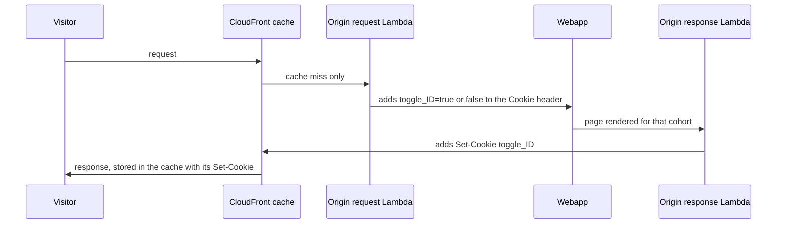
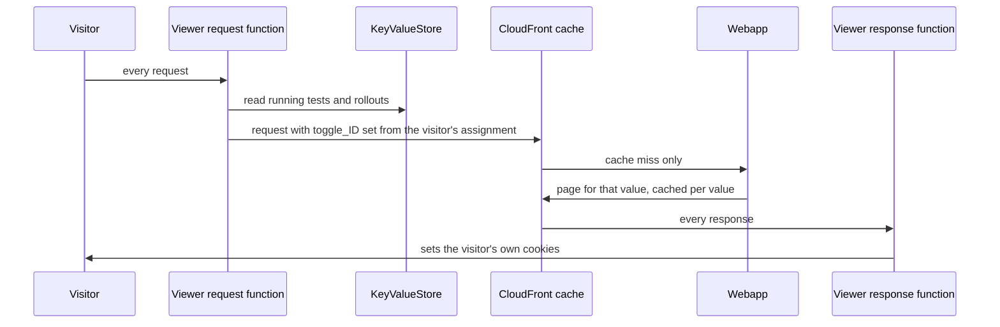

# RFC 094: A/B tests and percentage rollouts on wellcomecollection.org

## Purpose

This RFC proposes one mechanism for putting a share of visitors on a toggle, used both for A/B tests and for releasing a feature to a percentage of visitors. It replaces the A/B test assignment in our Lambda@Edge with a CloudFront Function that runs before the cache lookup, so that each visitor is assigned once and keeps their assignment. It also covers how percentages are changed, how those changes are recorded, and how membership is reported to Google Analytics.

**Last modified:** 2026-11-16T12:50:00+00:00

**Related issues:**

- [wellcomecollection.org#13836](https://github.com/wellcomecollection/wellcomecollection.org/issues/13836): rebuild the A/B test mechanism so one system handles A/B tests and rollouts. This RFC is a proposal for that ticket, and its spike answers the questions the ticket asks.
- [wellcomecollection.org#13785](https://github.com/wellcomecollection/wellcomecollection.org/issues/13785): release features to a percentage of visitors for beta testing. The decisions behind it are summarised in [#13786](https://github.com/wellcomecollection/wellcomecollection.org/issues/13786#issuecomment-6820850777).
- [wellcomecollection.org#13837](https://github.com/wellcomecollection/wellcomecollection.org/issues/13837) and [#13821](https://github.com/wellcomecollection/wellcomecollection.org/issues/13821): showing rollouts in the dashboard, and telling visitors they are in a beta. Both depend on this mechanism.

## Background

### Two needs, one mechanism

We have two reasons to give some visitors a different version of the site.

An A/B test compares two versions. Visitors in the test are split between a control and a variant, and we measure the difference. A test has a start and an end.

A rollout releases a feature flag, or a phase of a phased flag, to a percentage of visitors. The percentage is raised in steps until the feature is public. Visitors outside the rollout see what is public today.

Both need the same things from the platform: a stable, independent position for each visitor on each toggle, a percentage that can be changed, and a record of who got what. The beta testing work ([#13785](https://github.com/wellcomecollection/wellcomecollection.org/issues/13785)) decided to build rollouts on a rebuilt A/B mechanism for this reason, and this RFC follows that decision.

### How A/B tests work today

A test is defined twice: in [`cache/edge_lambdas/src/toggler.ts`](https://github.com/wellcomecollection/wellcomecollection.org/blob/main/cache/edge_lambdas/src/toggler.ts), which assigns visitors, and in [`toggles/webapp/toggles.ts`](https://github.com/wellcomecollection/wellcomecollection.org/blob/main/toggles/webapp/toggles.ts), which tells the webapp and the dashboard that the test exists.



The webapp reads the `toggle_ID` cookie and renders the matching version. It also writes the visitor's test cohorts into the GA dataLayer, as the `toggles` value, on each full page load.

Three tests have used this since 2023. None is running now.

### Problems with the current design

The Lambda runs at the origin-request event, which CloudFront only fires on a cache miss, after it has computed the cache key. Several problems follow from that.

1. Cohorts are assigned per cache miss. When a visitor without the cookie requests a page that is already cached, they receive the cached page, which was rendered for whichever cohort the earlier visitor was given. CloudFront also stores `Set-Cookie` headers with cached responses and replays them, so the visitor is given that same cohort's cookie. We confirmed the replay on our staging site. On a busy page this means one random draw per cache lifetime (an hour) per edge location. Visitors are not assigned independently, which is the assumption any analysis of the results depends on. [#13836](https://github.com/wellcomecollection/wellcomecollection.org/issues/13836) suspected this from the AWS documentation, and it is now tested.
2. The `range` setting, which is meant to limit a test to a share of traffic, is drawn again on every uncached request from a visitor who has no cookie yet. A visitor who is left out on one page can be enrolled on the next. A test set to 10% enrols most visitors who view enough pages.
3. Client-side navigation is never assigned. The `/_next/data/*` cache behaviour has no Lambda attached, so a visitor who arrives on one page and follows links to a page under test sees the default version and is not recorded as being in the test.
4. The cookie is a session cookie for one host. Returning visitors are assigned again and can change cohort.
5. When the Lambda sets its cookie it replaces any `Set-Cookie` header the webapp sent.
6. Each running test multiplies the number of cached copies of every page on the site, including pages the test does not affect, because `toggle_*` cookies are part of the cache key everywhere.
7. Adding or removing a test takes two definitions, a Lambda build, two Terraform applies and a manual version bump.

The first three mean that results from past tests cannot be treated as coming from a randomised sample of visitors. A rollout built on this would have the same faults: "10% of visitors" would not be 10%, and a visitor could move in and out.

## Requirements

1. A visitor has a stable position for each toggle, decided independently of other visitors, of other toggles and of the cache, and kept across visits.
2. Raising a percentage only adds visitors. Nobody who was in is removed.
3. It works for client-side navigation as well as full page loads.
4. A feature flag, or a phase of a phased flag, can be released to a percentage of visitors. Visitors outside see the public value.
5. An A/B test can change its exposure (the share of visitors in the test) and the split between its two versions while it runs.
6. Percentages are changed without a code deploy, and every change is recorded with a timestamp and kept.
7. A personal cookie, set from the dashboard or a `?toggle=` link, overrides the mechanism in both directions.
8. Membership is reported to Google Analytics for visitors who have consented to analytics. We accept that visitors who have not consented are not measured.
9. Tests and percentages are each listed in one place.
10. Pages stay cacheable, and a toggle does not reduce the cache hit rate on pages it does not affect.

Requirements 1, 2, 4, 7 and 8 restate acceptance criteria from [#13785](https://github.com/wellcomecollection/wellcomecollection.org/issues/13785). [Fit with the beta testing tickets](#fit-with-the-beta-testing-tickets) goes through that ticket and the others in its epic one criterion at a time.

## Proposal

### Overview

Assignment moves to a CloudFront Function on the viewer-request event. Viewer-request runs on every request before CloudFront looks in its cache, so the function can decide what the visitor should get and write it onto the request as the `toggle_ID` cookie that the cache key and the webapp already use. A second function on viewer-response stores the visitor's assignments in their browser. The list of running tests and rollouts, with their current percentages, lives in a CloudFront KeyValueStore that the function reads on each request.



The webapp keeps resolving toggles from `toggle_ID` cookies as it does now, and needs no change to do so. The existing toggler code is removed from the Lambda@Edge, and the origin-response Lambda, which does nothing else, is detached. The redirector stays where it is.

We tested this arrangement on a temporary CloudFront distribution in front of our staging site. The results are under [Evidence from the spike](#evidence-from-the-spike).

### Allocations

The function works from a list of allocations. An allocation says that some share of visitors should get a particular value for a particular toggle.

| | A/B test | Rollout |
| --- | --- | --- |
| Applies to | A test defined in `tests.ts` | A feature flag, or one phase of a phased flag |
| Exposure | The percentage of visitors in the test | The percentage of visitors who get the feature |
| Split | The percentage of those visitors who get the variant | None. Everyone in the rollout gets the feature. |
| Value written to `toggle_ID` | `true` for the variant, `false` for the control | `true` for a feature flag, the phase id for a phased flag |
| Visitors outside | No cookie, so the webapp treats them as not in the test | No cookie, so the webapp gives them the public value |
| Ends by | Being finished | The value becoming the public default |

Each allocation has a version number that increases by one whenever its percentages change.

### Assignment

The function keeps two cookies of its own on the visitor's browser. Neither is part of the cache key and neither is sent to the webapp. Both are set for `.wellcomecollection.org`, so the dashboard can read them, and both last six months from the visitor's most recent visit.

| Cookie | Contents | Purpose |
| --- | --- | --- |
| `wc_ab_bucket` | A random whole number from 0 to 9999 | A stable input for assignment that is shared by many visitors, so it does not identify one |
| `wc_ab` | One entry per allocation the visitor is in: toggle id, allocation version, and value | The record of what the visitor was given and under which percentages |

For each allocation, on each request:

1. If the request carries a personal `toggle_ID` cookie, leave it alone and stop. See [Personal cookies](#personal-cookies).
2. If the visitor has an entry for the toggle in `wc_ab`, use it.
3. Otherwise hash the toggle id together with the visitor's bucket number, and take two numbers from the hash. The first is compared with the exposure to decide whether the visitor is in. For a test, the second is compared with the split to decide which version they get. Including the toggle id in the hash gives each toggle its own audience, so the same visitors do not get every early feature.
4. If the visitor is in, add an entry to `wc_ab` recording the value and the allocation version in force.
5. Set `toggle_ID` on the request to the visitor's value, or remove it for visitors who are not in.

A visitor who is not in has no entry. Because the hash is deterministic they stay out for as long as the exposure is unchanged, and they are considered again when it rises.

Tests remain two-way, with a control and a variant, which is what `useABTest` and the `toggle_ID` cookie already express. Tests with more than two versions are not part of this proposal.

### Changing percentages

- Raising exposure adds visitors. Nobody already in is affected. This is the normal step for a rollout.
- Lowering exposure stops new visitors being added above the new level. Visitors already in stay in, because their entry in `wc_ab` is used first. The beta testing plan assumes rollout percentages only go up, and this proposal does not depend on that.
- Changing a test's split applies to visitors who join from then on. Visitors already in the test keep their cohort.

Changing the split while a test runs has a cost that this design does not remove. Visitors enrolled before and after the change were divided in different proportions, so pooling them can give a misleading result, including the wrong sign (Simpson's paradox). Experimentation tools treat a split change as the start of a new phase for this reason, and [GrowthBook's guidance](https://docs.growthbook.io/app/making-experiment-changes) is a clear statement of the options. Recording the allocation version with each assignment is what lets results be analysed per version, and pooled only across versions with the same split. I think the guidance for people running tests should be that exposure can be changed freely and split should be changed only with the analyst's agreement.

A change takes about a minute to reach visitors. In our test the new value first appeared 34 seconds after the write, and for roughly 20 seconds after that requests saw old and new values interleaved. Each assignment records the version it was made under, so the interleaving does not make any visitor's record ambiguous.

### Personal cookies

Staff and testers put themselves on a chosen value today with a `toggle_ID` cookie, set from the toggles dashboard or a `?toggle=` link. That keeps working and takes priority, as the beta testing plan decided. If the request carries a `toggle_ID` cookie for a toggle that has an allocation, the function leaves it in place and does not make or record an assignment. This holds in both directions: `true` or a phase id puts someone in, and `off` keeps them out of a rollout they would otherwise be in. A value of `false` on a feature flag means no preference today, and the function treats it as no cookie.

Anyone can set that cookie, as they can today. It only selects between cached versions of a page that exist anyway.

### Limiting an allocation to the pages it affects

An allocation can list the path prefixes it applies to. Assignment is the same on every page, but the function only adds `toggle_ID` to requests for those paths. Pages outside them keep a single cached copy. For `/_next/data/BUILD/path.json` requests the function compares the page path inside the URL.

A test should always list its paths. A rollout of a feature that appears across the site may not be able to, and then every page has one cached copy for visitors in the rollout and one for visitors outside it.

### Where things are defined and published

A/B tests are defined in a new file, `toggles/webapp/tests.ts`, with an id, title, description, optional path prefixes, and two optional links: `documentationLink` for the test plan or hypothesis, and `dashboardLink` for the report where its results are read. This replaces the entry in `toggler.ts`, its `when` function, and the `tests` list in `toggles.ts`. Tests get their own file because they have a shape and a life that the other toggles do not: links, a split, and a start and an end.

Feature flags and phased flags stay in `toggles.ts`. A rollout is not defined in code. It is runtime state on a flag, in the same way a flag's public value is today.

Allocations are published as one file, `allocations.json`, next to `toggles.json` on `toggles.wellcomecollection.org`. It holds, for every test and rollout, the current percentages and version, the state, and the history of changes. It is the single place where percentages are listed, and the KeyValueStore is always written from it.

`toggles.json` keeps what the webapp needs and no more: the ids and titles of tests that have not finished, so that their cookies are accepted, and for each flag with a rollout in progress, the value being rolled out and its percentage. The webapp's fetch of `toggles.json` does not change.

Keeping history out of `toggles.json` matters because every webapp instance fetches that file each minute.

### Commands

Percentages are changed with a command in `toggles/webapp`, alongside `setDefaultValueFor`:

```
yarn setAllocation --id=newTags --exposure=25 --split=50          # an A/B test
yarn setAllocation --id=brandUpdate --exposure=10                 # a feature flag rollout
yarn setAllocation --id=imageSidebarPhases --phase=phase3 --exposure=25   # a phase rollout
```

The command:

1. reads the published `allocations.json`,
2. increases the allocation's version and appends an entry to its history (version, exposure, split, timestamp),
3. writes `allocations.json`,
4. writes the running allocations to the KeyValueStore, and
5. updates the summary in `toggles.json` if it has changed.

If a later write fails after `allocations.json` is written, running the command again repairs it.

The history in `allocations.json` is the durable record of when each percentage changed. It is published, so the dashboard can show it and the analyst can read it without AWS access. The file is public, so entries do not include who made the change.

The KeyValueStore holds all running allocations under one key. Values are limited to 1 KB, which is enough for several at once, and the command fails with a clear message if the limit would be exceeded. If we come to need more, the list can be split across keys.

A developer runs the command. The dashboard shows percentages and does not edit them, as [#13785](https://github.com/wellcomecollection/wellcomecollection.org/issues/13785) asks. That ticket also says a change "requires a code change and deploy", which this replaces with a command. The reasons are under [Fit with the beta testing tickets](#fit-with-the-beta-testing-tickets), and I propose the criterion is reworded to say a developer changes it with a command.

### The life of an A/B test

A test moves through three states, and each move is recorded in `allocations.json` with a timestamp.

| State | How it gets there | What visitors get | Personal cookie |
| --- | --- | --- | --- |
| Ready | The definition is merged and `yarn deploy` is run | Nobody is enrolled | Works |
| Running | The first `yarn setAllocation` | Enrolled according to the allocation | Works |
| Finished | `yarn finishAllocation` | Nobody is in the test | Stops working |

A ready test is listed in `toggles.json`, so the webapp accepts its cookie and the variant can be checked on staging and production before any visitor is enrolled. The edge function does not know about it yet.

The first allocation starts the test. It becomes version 1, the start time is recorded, and the test is written to the KeyValueStore. From about a minute later the function enrols visitors.

A running test can be paused by setting its exposure to 0. No new visitors are enrolled, and visitors already in the test keep their cohort.

Finishing a test is one command:

```
yarn finishAllocation --id=newTags
```

It marks the test finished in `allocations.json` with the time, removes it from the KeyValueStore, and removes it from the list in `toggles.json`. About a minute later the function stops setting `toggle_ID` for it, so every visitor gets the control version, and the function drops the test's entry from each visitor's `wc_ab` cookie on their next request. Because it takes effect that quickly and needs no deploy, finishing is also how a test is stopped in a hurry if a variant turns out to be broken.

Finishing sends everyone to the control version, including visitors who had the variant. If the variant is the version we are keeping, the code change that makes it unconditional should be released before the test is finished, so that those visitors do not go back to the old version for a while.

A finished test stays finished. Its record and history remain in `allocations.json`, and its definition and any remaining code that reads it can then be removed. Running the same idea again means a new test with a new id, so that the two sets of assignments and results are never mixed.

`yarn deploy` protects these states. It refuses to run if the definition of a ready or running test has been deleted from `tests.ts`, with a message saying to finish the test first.

### The life of a rollout

A rollout starts with the first `yarn setAllocation` for a flag or a phase. A flag can have one rollout at a time.

Raising it is the same command with a higher exposure.

A rollout is completed by making its value the public default and then ending the allocation:

```
yarn setDefaultValueFor --brandUpdate=true
yarn finishAllocation --id=brandUpdate
```

Done in that order, visitors in the rollout see no change, and visitors outside it get the feature when the public value changes. This matches the criterion that taking a rollout to 100% makes it the public default. Setting the exposure to 100 without changing the public value would leave non-consenting visitors on the old version (see [Consent](#consent)), so 100% is reached by changing the default, not through the allocation.

A rollout is abandoned with `yarn finishAllocation` alone. About a minute later every visitor is back on the public value. This is the quick way to withdraw a feature that is causing problems.

For a phased flag, a rollout of one phase leaves the public phase as it is. Visitors outside the rollout see the public phase, or nothing if no phase is public yet.

### Reporting to Google Analytics

Two things are reported.

The first is the existing `toggles` value in the dataLayer. It lists the tests a visitor is in today, and [#13785](https://github.com/wellcomecollection/wellcomecollection.org/issues/13785) asks for visitors in a rollout to appear in it in the same way, so that existing report filters work. The webapp can do this as it does now, because the page it renders is specific to the visitor's value: a flag that has a rollout in progress and is on for this request is added to the value by its id. Visitors outside the rollout do not carry it. The deploy check that keeps the value within GA's 100-character limit is extended to count rollouts.

The second is new and applies to A/B tests. It follows [Google's convention for experiment integrations](https://developers.google.com/analytics/devguides/collection/ga4/integration): an `experience_impression` event with an `exp_variant_string` parameter.

- The event is sent when a component that depends on a test renders, through a small hook that wraps `useABTest`. A visitor who is assigned to a test but never reaches the page it changes is not counted as exposed.
- The value has the form `wc-TESTID.vVERSION-COHORT`, for example `wc-newTags.v3-variant`, which fits GA's 100-character limit on parameter values.
- The hook reads the version from the `wc_ab` cookie in the browser. The version is not rendered into the page, because the cached page is shared by visitors assigned under different versions.
- The hook does not send the event when the visitor's value came from a personal cookie.

The `toggles` value says who is in. The event says who saw the thing under test and under which percentages, which is what a test's analysis needs, particularly if its split has changed. Both go through the existing GTM consent handling.

The event needs a GTM tag and a custom dimension for `exp_variant_string`, which is the analyst's to set up. Google's guide describes audiences per variant, created through the Admin API by third-party tools. We would not be doing that automatically, and a custom dimension analysed in Explorations or BigQuery may be all we need.

The beta testing plan assumes people who switch a toggle on for themselves are internal traffic, which GA already filters. They appear in the `toggles` value as they do today.

### Consent

A visitor is only given an assignment once they have accepted analytics cookies. The function reads the consent cookie that our consent banner sets, which is already part of the cache key. Visitors who have not consented get the public version of everything and are given neither `wc_ab_bucket` nor `wc_ab`. If consent is withdrawn, the viewer-response function removes both cookies.

For A/B tests this is the cautious reading. The ICO's [guidance on storage and access technologies](https://ico.org.uk/for-organisations/direct-marketing-and-privacy-and-electronic-communications/guidance-on-the-use-of-storage-and-access-technologies/what-are-the-exceptions/) lists A/B testing as an example likely to meet the statistical purposes exception, which would allow enrolling visitors without consent provided they are told and can object. That exception has conditions, and the guidance does not discuss a cookie that keeps a visitor's cohort. Enrolling only consenting visitors costs a test nothing in measurement, since they are the only visitors GA records.

For rollouts it has a consequence that the beta testing plan has not considered. A rollout "to 25%" would reach 25% of visitors who have accepted analytics cookies, which is a smaller share of all visitors. I do not think the statistical purposes exception is a good fit for a rollout, where the cookie decides which version of the site someone is given. Whether a rollout cookie can be set without consent on some other basis is the most important open question in this RFC, and it needs advice from whoever advises us on data protection.

A visitor's first page view usually happens before they have answered the consent banner, so they are assigned from their next request after accepting.

Kiosk devices are treated as consenting by the webapp. I propose excluding them from tests and rollouts, because they show a different version of the site to a different audience.

### Failure handling

A CloudFront Function that throws returns a 503 to the visitor, and CloudFront will publish a function that contains a syntax error. We met both while building the spike. So:

- The handler catches every error and returns the request unchanged, which means the visitor gets the public version.
- A missing or unreadable KeyValueStore entry is treated as nothing running.
- CI runs `aws cloudfront test-function` against the new code with sample events, including a request with no cookies and one with malformed cookies, and does not publish if any fails.
- The function is deployed to the staging distribution first, as the Lambda is now.

[#13836](https://github.com/wellcomecollection/wellcomecollection.org/issues/13836) asks whether we want an alarm on the cache hit rate. I think we do, alongside an alarm on function errors, since both are ways this mechanism could quietly cost us.

### Dashboard

Rollouts are shown on the toggles page, as [#13837](https://github.com/wellcomecollection/wellcomecollection.org/issues/13837) describes: a badge with the percentage, and a line saying whether this browser is inside or outside the rollout. This mechanism gives that ticket what it needs.

- The percentage and the value being rolled out are in `toggles.json`.
- Whether this browser is inside is read from the `wc_ab` cookie, which the dashboard can see because it is set for `.wellcomecollection.org`. The dashboard does not need its own copy of the hash.
- When each change happened is in `allocations.json`.

A/B tests get their own page next to the toggles page. The "A/B tests" group on the toggles page today is a personal control: it lets you count yourself in or out of a test in your own browser. That stays there as a short row per test that links to the new page. The new page is a record of each test, for someone checking on it: description, state, current exposure, split and version, the change history, and the links to its documentation and results. It is read-only.

The existing dashboard type for tests does not match what is published and causes an error when searching while a test exists, which is fixed as part of this work.

If we want to reduce scope, the tests page is the part to defer.

### What changes where

| Area | Change |
| --- | --- |
| `cache/` | Two CloudFront Functions and a KeyValueStore. Functions attached to the behaviours that have the Lambda today, and to `/_next/data/*`. Toggler removed from the Lambda@Edge. Origin-response Lambda detached. Alarms for function errors and cache hit rate. |
| `toggles/webapp` | Tests move to their own `tests.ts`, with optional paths and links. New `setAllocation` and `finishAllocation` commands. Published `allocations.json`. `toggles.json` carries a summary of tests and rollouts. |
| `common/` | Rollouts added to the `toggles` dataLayer value. Exposure hook and event for tests. |
| `dash/webapp` | Rollout display on the toggles page ([#13837](https://github.com/wellcomecollection/wellcomecollection.org/issues/13837)). New tests page. Type fix. |
| Docs | The cache and toggles READMEs, and the cookie policy entry for the new cookies. |
| GTM and GA | Tag and custom dimension for the new event. |

## Fit with the beta testing tickets

This section checks the proposal against the tickets in the beta testing epic. Where it does something different from what a ticket asks, the difference and the reason are stated here so that the ticket can be updated or the proposal changed.

### Where this proposal differs, and why

| What the tickets say | What this proposes | Why |
| --- | --- | --- |
| "Rollout percentages are changed by PR and deploy" ([#13785](https://github.com/wellcomecollection/wellcomecollection.org/issues/13785)) | A developer runs `yarn setAllocation`. No PR and no deploy. | A/B tests need their percentages changed while they run, and one mechanism means one way of changing them. A command also lets a rollout be withdrawn in about a minute if a feature is causing problems, which a PR cannot. The plan behind the ticket asked for something as simple as `setDefaultValueFor`, which is also a command run by a developer with no PR. What a PR would give us is a review and a record. The record is kept in the published history. The review is lost, as it already is for a flag's public value. |
| "Given a flag's rollout is raised to 100%, the rolled-out value becomes the public default" ([#13785](https://github.com/wellcomecollection/wellcomecollection.org/issues/13785), [#13836](https://github.com/wellcomecollection/wellcomecollection.org/issues/13836)) | A rollout is completed by setting the public default with `setDefaultValueFor` and then ending the allocation. Exposure is not set to 100. | Under the consent position below, an allocation only reaches consenting visitors, so 100% of an allocation is not everyone. Making the value public is what reaches everyone. The outcome the tickets ask for is the same: the value becomes the default, and the badge and beta label go without editing a page. |
| A visitor with no personal cookie is in a 10% rollout if their position falls within the 10% ([#13785](https://github.com/wellcomecollection/wellcomecollection.org/issues/13785)) | That holds only for visitors who have accepted analytics cookies. Others get the public value. | Being in a rollout requires storing something on the visitor's device, and we have not established a basis for doing that without consent. The tickets do not discuss consent. This is open question 1, and if the answer allows it, the restriction is removed and the criterion is met as written. |
| Percentages never go down. "It is built assuming they only go up." ([#13786](https://github.com/wellcomecollection/wellcomecollection.org/issues/13786#issuecomment-6820850777)) | Exposure can be lowered. Visitors already in stay in. | A/B tests need it, for pausing enrolment. It costs rollouts nothing, and the guarantee that matters to the tickets, that nobody who was in is removed, still holds. |
| Visitors outside a rollout "see the previous phase" ([#13785](https://github.com/wellcomecollection/wellcomecollection.org/issues/13785)) | Visitors outside see the public value, and a flag has one rollout at a time. | The public value is what the webapp already gives a visitor with no cookie, so nothing new is needed. It is the previous phase whenever phases are released in order. It differs only if a phase were rolled out while the phase before it was not yet public, which I do not think we want to support. |
| The dashboard works out whether this browser is in a rollout from "the user's number in a cookie shared across `*.wellcomecollection.org`, and a second copy of the hash function in the dashboard" ([#13786](https://github.com/wellcomecollection/wellcomecollection.org/issues/13786#issuecomment-6820850777)) | The dashboard reads the stored assignment from the `wc_ab` cookie. It has no copy of the hash. | The assignment is stored anyway, for tests. Reading it avoids two implementations of the hash that could drift apart. The limit is that it reflects what the browser was last given on the site: a browser that has not visited since a percentage was raised, or has not accepted analytics cookies, shows as outside. |
| "Tests and percentages are listed in one place" ([#13836](https://github.com/wellcomecollection/wellcomecollection.org/issues/13836)) | Test definitions are in `tests.ts`. All percentages, for tests and rollouts, are in the published `allocations.json`, not in code. | Percentages are runtime state that a command changes, like a flag's public value. Putting them in code would bring back the deploy. Each kind of thing still has one place. |
| Rollout membership appears "in the existing toggles value" ([#13785](https://github.com/wellcomecollection/wellcomecollection.org/issues/13785)) | It does. For an allocation limited to some paths, it appears on those pages only. | The function only sets the cookie on the pages a toggle affects, to keep other pages to one cached copy. Today a test appears in the value on every page once assigned. A rollout with no path limit appears everywhere. |

### Criteria the proposal meets as written

| Ticket | Criterion | How |
| --- | --- | --- |
| [#13785](https://github.com/wellcomecollection/wellcomecollection.org/issues/13785) | A phase of a phased flag can be rolled out | The allocation's value is the phase id |
| [#13785](https://github.com/wellcomecollection/wellcomecollection.org/issues/13785) | Raising the percentage only adds visitors | Deterministic hash, and the stored assignment is used first |
| [#13785](https://github.com/wellcomecollection/wellcomecollection.org/issues/13785) | Each flag has its own audience | The toggle id is part of the hash |
| [#13785](https://github.com/wellcomecollection/wellcomecollection.org/issues/13785) | Visitors outside a rollout are treated as general visitors | They carry no cookie and do not appear in the `toggles` value |
| [#13785](https://github.com/wellcomecollection/wellcomecollection.org/issues/13785), [#13836](https://github.com/wellcomecollection/wellcomecollection.org/issues/13836) | A personal cookie overrides the rollout in both directions, including a personal `off` | The function leaves a personal `toggle_ID` cookie alone |
| [#13785](https://github.com/wellcomecollection/wellcomecollection.org/issues/13785) | The dashboard shows the percentage and cannot edit it | The percentage is in `toggles.json`. There is no write path from the dashboard. |
| [#13836](https://github.com/wellcomecollection/wellcomecollection.org/issues/13836) | The assignment is saved in a cookie with an expiry we choose on purpose | Six months from the last visit, which is open question 7 |
| [#13836](https://github.com/wellcomecollection/wellcomecollection.org/issues/13836) | A user keeps the same experience across visits until the cookie expires | The stored assignment |
| [#13837](https://github.com/wellcomecollection/wellcomecollection.org/issues/13837) | It is clear when each rollout step happened | The history in `allocations.json` |
| [#13821](https://github.com/wellcomecollection/wellcomecollection.org/issues/13821) | Visitors in a rollout see a beta label, and it goes at 100% without editing the page | The webapp shows the label when a flag is on for the request and `toggles.json` says it has a rollout in progress. Completing the rollout removes that entry. |
| [#13786](https://github.com/wellcomecollection/wellcomecollection.org/issues/13786#issuecomment-6820850777) | `?toggleOverride=` beats the rollout for one page load | The webapp already resolves an override ahead of the cookie, and the query string is part of the cache key |
| [#13786](https://github.com/wellcomecollection/wellcomecollection.org/issues/13786#issuecomment-6820850777) | Someone can be in on a phone and out on a laptop | Assignment is per browser |
| [#13786](https://github.com/wellcomecollection/wellcomecollection.org/issues/13786#issuecomment-6820850777) | People who switch a toggle on for themselves are not tracked specifically | They appear in the `toggles` value as now. The new exposure event leaves them out. |

Three other tickets are unaffected. A shorter-lived `?toggle=` link ([#13834](https://github.com/wellcomecollection/wellcomecollection.org/issues/13834)) and the link builder ([#13835](https://github.com/wellcomecollection/wellcomecollection.org/issues/13835)) both set a personal cookie, which the function leaves alone, and when that cookie expires the visitor returns to their own assignment. The `on` cookie value ([#13847](https://github.com/wellcomecollection/wellcomecollection.org/issues/13847)) is a personal value like `true`, and that ticket already says A/B test cookies stay as they are. For collecting feedback from beta participants ([#13822](https://github.com/wellcomecollection/wellcomecollection.org/issues/13822)), the `wc_ab` cookie is readable in the browser, so a feedback tool could target visitors who are in a given rollout.

### Questions asked in #13836

| Question | Answer |
| --- | --- |
| Does the assignment run early enough to cover users with no cookie, given CloudFront's cache? | Not today. It does at viewer-request, which the spike confirmed. |
| How do we change the percentage? | `yarn setAllocation`, modelled on `setDefaultValueFor`. No deploy. Takes effect in about a minute. |
| Which field do we send rollout membership in? | The existing `toggles` value, by flag id, within the same 100-character check. |
| Is the change in cost acceptable, and do we want alarms for the cache hit rate? | Cost needs estimating from request volume (see Impact). I propose alarms on cache hit rate and on function errors. |
| Does this still allow us to do A/B tests? | Yes. A test is an allocation with a split. |

## Evidence from the spike

We deployed the two functions and a KeyValueStore on a temporary distribution with our staging site as its origin, using the same cookies in the cache key as production. A published feature flag stood in for a toggle so that the page body showed which value the webapp had seen.

| Question | Result |
| --- | --- |
| Does a cookie written by the viewer-request function form the cache key? | Yes. Two visitors with the same value shared one cached page. A visitor with the other value got a separate one with the other content. |
| Does a cookie set at viewer-response stay out of the cache? | Yes. Two new visitors were both served from the cache and each received their own cookie. |
| Can the viewer-request function pass data to the viewer-response function? | Yes, in a request header. |
| Does the function run for `/_next/data` requests? | Yes, with the same assignment and caching behaviour as pages. |
| Does the webapp need to change to read the value? | No. It rendered the value from the cookie the function wrote. |
| How quickly does a KeyValueStore change take effect? | About a minute in one trial, with a short period of mixed old and new values. |

The spike did not include the Lambda@Edge redirector or our WAF. Both are on the staging distribution, where the function would be deployed first.

## Alternatives considered

### Fix the current Lambda in place

The origin-request event runs after the cache key is computed and only on a miss. No change to the Lambda's code can make assignment per visitor while pages are cached. Stopping CloudFront from caching the `Set-Cookie` header would leave visitors receiving a cached version with no cookie at all.

### Lambda@Edge on viewer-request

This would work. A Lambda@Edge function can make network calls, so it could read config from S3 or DynamoDB. It is slower and more expensive per request than a CloudFront Function, it would run on every request to the site, and it keeps the manual version step in our deploy. The KeyValueStore gives a CloudFront Function the one thing it lacked, which is config that changes without a deploy. AWS's own [guidance on A/B testing at the edge](https://builder.aws.com/content/2wDnCagIOmd3iAksaGFsBt9CUAP/application-performance-a-b-testing) recommends CloudFront Functions with a KeyValueStore for this case and Lambda@Edge only when the KeyValueStore's limits are a problem.

### Assign in the webapp

The webapp could assign visitors if the affected pages were not cached, or were cached per visitor. Our pages are served from the cache most of the time, and the catalogue APIs behind them are sized on that basis.

### Assign in the browser

Client-side assignment needs no infrastructure. The page would render the public version on the server and switch after load, which visitors see as a flicker, and it would make server and client rendering disagree.

### Adopt an experimentation tool

Tools such as GrowthBook provide assignment, rollouts, a results dashboard and statistics. We would still need the edge function, because the value has to be in the cache key before the page is served, and we would be adding a service and its SDK next to a toggles system and dashboard we already have. The assignment and change semantics proposed here follow GrowthBook's, so moving to it later would not mean changing how tests behave.

### Assign by hash alone, with no stored assignment

Without the `wc_ab` record, a visitor's value would be recomputed from the hash on every request. That is simpler and needs one fewer cookie, and it is enough for rollouts whose percentage only rises. A change of split would move some visitors from one version to the other, and the dashboard and the GA event would have no record of the version a visitor was assigned under. The requirement to change a test's split while it runs rules it out.

### Separate mechanisms for tests and rollouts

Rollouts could be built into the webapp's toggle resolution and tests left at the edge. Both would still need a per-visitor position that is in the cache key before the page is served, which is the part that is hard. Building it once is less work and gives one place to look when something is wrong.

## Impact

- Experiment results become usable, and rollouts become possible. These are the reasons for the change.
- Every request to the site runs a CloudFront Function and reads the KeyValueStore, including when nothing is running. CloudFront Functions are priced per invocation. The cost needs estimating from our request volume before we commit, and I expect it to be small next to what we pay for the two Lambda@Edge invocations on each cache miss today, one of which goes away.
- A fault in the function affects every page. The failure handling above is how we limit that, and it is the main operational risk of the proposal.
- The cache holds up to three copies of each page a test applies to (not enrolled, control, variant), two copies of each page a rollout applies to, and one copy of every other page. Today every page on the site is affected by every test. A rollout with no path limit affects every page.
- Two new first-party cookies are set for consenting visitors. The cookie policy needs updating.
- The analyst's existing filters on the `toggles` value keep working and gain rollouts. Reports for future tests can use the new event.
- Adding a test becomes a change to `tests.ts` and a `yarn deploy`. Starting, changing and finishing a test or a rollout are one command each.

## Open questions

1. Can a rollout reach visitors who have not accepted analytics cookies? If not, is a rollout to a share of consenting visitors good enough for beta testing? This needs a view from whoever advises us on data protection.
2. For A/B tests, is enrolling only consenting visitors the right position, or should we use the statistical purposes exception?
3. Should kiosk devices be excluded from tests and rollouts?
4. Is the `toggles` value enough for analysing rollouts, or does the analyst want the versioned event for them as well?
5. Is a custom dimension on the exposure event enough for analysing tests, or does the analyst want GA audiences per variant?
6. Should a change of split be allowed from the command at all, or require a new test?
7. Is six months the right lifetime for the two cookies?

## Next steps

1. Review of this RFC by the Digital Experience and Digital Platform teams, and by the analyst.
2. Answers to the consent questions.
3. Fixes that do not depend on the RFC: the dashboard type and search error, and corrections to the cache and toggles READMEs.
4. Build the functions, the KeyValueStore, the CI check and the alarms, and deploy to staging with an allocation that changes nothing visible.
5. Add `allocations.json`, the two commands and the summary in `toggles.json`. Move tests to `tests.ts`.
6. Add rollouts to the `toggles` value, and the exposure hook and GTM tag for tests. Check both in GA's DebugView.
7. Deploy to production with nothing configured, then remove the toggler from the Lambda@Edge.
8. Dashboard work in [#13837](https://github.com/wellcomecollection/wellcomecollection.org/issues/13837), and the tests page.
9. Run a first rollout and a first test, and check the share of visitors against the configured percentages.
