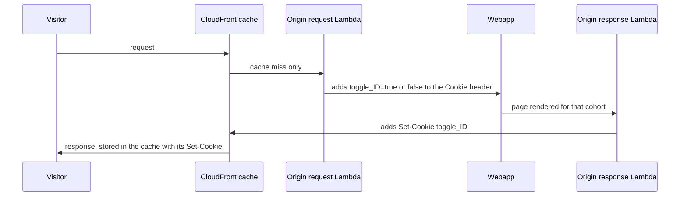
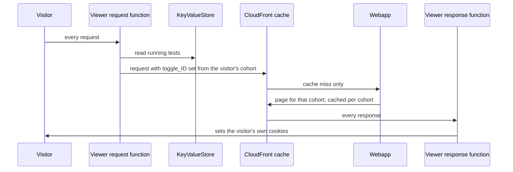

# RFC 094: Beta tests on wellcomecollection.org

## Purpose

This RFC proposes a mechanism for beta tests on wellcomecollection.org. A beta test shows a feature that is ready to a fixed share of visitors for a set period, so that we find problems and hear feedback before it goes to everyone, and it ends with a decision to release the feature or roll it back. The mechanism replaces the A/B test assignment in our Lambda@Edge with a CloudFront Function that runs before the cache lookup, so that each visitor is assigned once, independently, and keeps what they were given.

The Digital Experience team wants to get working changes in front of visitors sooner. Beta tests are meant to make a larger change less risky to release, so that we release more often. The RFC also sets out why a test's percentages are fixed while it runs and how tests are reported to Google Analytics.

**Last modified:** 2026-11-25T11:20:00+00:00

**Related issues:**

- [wellcomecollection.org#13836](https://github.com/wellcomecollection/wellcomecollection.org/issues/13836): rebuild the A/B test mechanism. This RFC is the proposal for that ticket, and its spike answers the questions the ticket asks.
- [wellcomecollection.org#13785](https://github.com/wellcomecollection/wellcomecollection.org/issues/13785): release features to a percentage of visitors for beta testing. [How this relates to the beta testing tickets](#how-this-relates-to-the-beta-testing-tickets) explains how this proposal meets that need and where it differs from what the ticket describes.

## Background

### What a beta test is

A beta test puts a feature in front of some visitors before all of them. The feature is finished enough to release. We show it to a share of visitors chosen at random, watch for problems and collect feedback, and then either release it to everyone or take it away.

Mechanically this is an A/B test. Visitors are divided at random into those who get the feature (the variant) and those who do not (the control), each visitor keeps their group, and the group is recorded in Google Analytics. This RFC rebuilds the existing A/B test mechanism and calls what it provides a beta test, because the main use is releasing changes with less risk. Measuring the size of an effect is possible and optional.

Two rules follow from that purpose.

- The percentages are decided before the test starts and stay fixed while it runs.
- The test ends with a recorded decision: release the feature, roll it back, or revise it and test again.

A beta test is not a gradual release. The beta testing ticket ([#13785](https://github.com/wellcomecollection/wellcomecollection.org/issues/13785)) describes a percentage that rises over time. In review the Digital Experience team said they do not need that: a feature goes to a fixed share of visitors, for example 20%, and then to everyone or to nobody. This RFC proposes that, and does not provide a percentage that is raised step by step.

### The beta label

A feature in a beta test may tell visitors that it is in beta and ask for their feedback ([#13821](https://github.com/wellcomecollection/wellcomecollection.org/issues/13821)). Whether it does, and where, is decided in the work on that feature. A label is part of the variant's page, and this mechanism has no part in it.

A label affects what a test can tell us, and we accept that. People who know they are being shown something new behave differently, and only the variant group is told. A difference between the two groups then describes the labelled feature, and it cannot be read as the effect the feature will have once the label is gone. That suits a test whose purpose is to find problems and gather feedback.

### Enrolment and split

Two percentages describe a test, and the rest of this RFC uses these names for them.

- Enrolment is the share of visitors who are in the test at all. Everyone else is outside it: they see the site as it is and are recorded as outside.
- Split is the share of the visitors in the test who get the variant. The rest of the visitors in the test are the control group, who see the site as it is and are recorded.

The share of all visitors who see the variant is the two multiplied together. Taking 10,000 visitors:

| Enrolment | Split | In the test | Variant | Control | Outside the test |
| --- | --- | --- | --- | --- | --- |
| 100 | 20 | 10,000 | 2,000 | 8,000 | 0 |
| 100 | 50 | 10,000 | 5,000 | 5,000 | 0 |
| 50 | 50 | 5,000 | 2,500 | 2,500 | 5,000 |
| 20 | 50 | 2,000 | 1,000 | 1,000 | 8,000 |

The first row is the usual shape of a beta test: a fifth of visitors get the feature and everyone else is the control group. A split of 50 gives the most precise comparison for a given number of visitors, and a test that sets out to measure an effect would normally use it. A lower split shows the feature to fewer visitors and still leaves a large group to compare them with. Enrolment below 100 keeps some visitors out of the test altogether, and is what the safety ramp at the start of a test lowers.

The control group and the visitors outside the test see the same thing, and they are not the same group. The control group was chosen in the same draw as the variant group, which is what makes the two comparable, and a test is designed around the comparison between them. The visitors outside are recorded as well, so that the analyst can tell them apart from the control group.

A team can read a beta test against the metrics it already tracks. The control group is there as well, at no extra cost, and I think it is the better comparison because it covers the same days as the variant. If an exhibition opens or traffic shifts during the test, the control group sees the same change, and a baseline from an earlier period does not.

Under the consent position in this RFC, both percentages are shares of visitors who have accepted analytics cookies. See [Consent](#consent).

### How A/B tests work today

A test is defined twice: in [`cache/edge_lambdas/src/toggler.ts`](https://github.com/wellcomecollection/wellcomecollection.org/blob/main/cache/edge_lambdas/src/toggler.ts), which assigns visitors, and in [`toggles/webapp/toggles.ts`](https://github.com/wellcomecollection/wellcomecollection.org/blob/main/toggles/webapp/toggles.ts), which tells the webapp and the dashboard that the test exists.



The webapp reads the `toggle_ID` cookie and renders the matching version. It also writes the visitor's test cohorts into the GA dataLayer, as the `toggles` value, on each full page load.

Three tests have used this since 2023. None is running now.

### Problems with the current design

The Lambda runs at the origin-request event, which CloudFront only fires on a cache miss, after it has computed the cache key. Several problems follow from that.

1. Cohorts are assigned per cache miss. When a visitor without the cookie requests a page that is already cached, they receive the cached page, which was rendered for whichever cohort the earlier visitor was given. CloudFront also stores `Set-Cookie` headers with cached responses and replays them, so the visitor is given that same cohort's cookie. We confirmed the replay on our staging site. On a busy page this means one random draw per cache lifetime (an hour) per edge location. Visitors are not assigned independently, so a test set to 20% does not reach a stable 20% of visitors, and no analysis of the results is sound. [#13836](https://github.com/wellcomecollection/wellcomecollection.org/issues/13836) suspected this from the AWS documentation, and it is now tested.
2. The `range` setting, which is meant to limit a test to a share of traffic, is drawn again on every uncached request from a visitor who has no cookie yet. A visitor who is left out on one page can be enrolled on the next. A test set to 10% enrols most visitors who view enough pages.
3. Client-side navigation is never assigned. The `/_next/data/*` cache behaviour has no Lambda attached, so a visitor who arrives on one page and follows links to a page under test sees the default version and is not recorded as being in the test.
4. The cookie is a session cookie for one host. Returning visitors are assigned again and can change cohort.
5. When the Lambda sets its cookie it replaces any `Set-Cookie` header the webapp sent.
6. Each running test multiplies the number of cached copies of every page on the site, including pages the test does not affect, because `toggle_*` cookies are part of the cache key everywhere.
7. Adding or removing a test takes two definitions, a Lambda build, two Terraform applies and a manual version bump.

The first three mean that results from past tests cannot be treated as coming from a randomised sample of visitors.

## Requirements

1. A visitor is assigned to a cohort once, independently of other visitors, of other tests and of the cache, and keeps it across visits.
2. Assignment works for client-side navigation as well as full page loads.
3. A test that sets out to measure an effect records a hypothesis, a primary metric, a planned sample or duration, and success criteria in its definition before it starts.
4. A test's enrolment (the share of visitors in the test) and split (the share of those who get the variant) are set in its definition and fixed while it runs. A change is an exception that needs a recorded reason and starts a new analysis period.
5. A test's definition is merged and deployed before the test starts. Starting, changing and finishing it then need no code deploy, and each is recorded with a timestamp and kept in the published record of the test.
6. The version of the site a visitor was given is recorded in Google Analytics for visitors who have consented to analytics, with enough detail to analyse each period separately. Visitors who have not consented are not enrolled or measured, which limits how many visitors a test can reach.
7. A test ends with a recorded decision.
8. A personal cookie, set from the dashboard or a `?toggle=` link, overrides assignment, so staff can preview either version. Previews do not count in results. See [Staff previews](#staff-previews).
9. A test is defined in one place.
10. Pages stay cacheable, and a test does not reduce the cache hit rate on pages it does not affect.

## Proposal

### Overview

Assignment moves to a CloudFront Function on the viewer-request event. Viewer-request runs on every request before CloudFront looks in its cache, so the function can decide the visitor's cohort and write it onto the request as the `toggle_ID` cookie that the cache key and the webapp already use. A second function on viewer-response stores the visitor's assignments in their browser. The list of running tests, with their percentages, lives in a CloudFront KeyValueStore that the function reads on each request.



The webapp keeps reading `toggle_ID` as it does now, and needs no change to do so. The existing toggler code is removed from the Lambda@Edge, and the origin-response Lambda, which does nothing else, is detached. The redirector stays where it is.

We tested this arrangement on a temporary CloudFront distribution in front of our staging site. The results are under [Evidence from the spike](#evidence-from-the-spike).

### Assignment

The function works from the list of running tests in the KeyValueStore. Each entry names a test, its enrolment and its split.

The function keeps two cookies of its own on the visitor's browser. Neither is part of the cache key and neither is sent to the webapp. Both are set for `.wellcomecollection.org`, so the dashboard can read them, and both last six months from the visitor's most recent visit.

| Cookie | Contents | Purpose |
| --- | --- | --- |
| `wc_ab_bucket` | A random whole number from 0 to 9999 | A stable input for assignment that is shared by many visitors, so it does not identify one |
| `wc_ab` | One entry per running test: test id, version, and cohort (`variant`, `control` or `outside`) | The record of what the visitor was assigned and under which percentages |

`wc_ab` is a single cookie that holds an entry for every running test. Each entry is the test id, the version and the cohort joined by colons, and entries are separated by a vertical bar. A visitor who is in two tests and outside a third has, for example, `wc_ab=newTags:2:variant|searchFilters:1:control|imageSidebar:1:outside`. The function writes it and the webapp reads it.

One cookie could hold the bucket number as well. They are kept apart because the bucket number never changes, while the list is rewritten as tests start and finish. A list that cannot be parsed is discarded and rebuilt from the hash, and the visitor keeps their bucket number.

A test has a version number that increases by one whenever its percentages change. A change takes about a minute to reach visitors. In our test the new value first appeared 34 seconds after the write, and for roughly 20 seconds after that requests saw old and new values interleaved. Each assignment records the version it was made under, so the interleaving does not make any visitor's record ambiguous.

For each running test, on each request:

1. If the request carries a personal `toggle_ID` cookie for the test, leave it alone and stop.
2. If the visitor has an entry for the test in `wc_ab`, use it. The exception is an `outside` entry made under an earlier version, which is assigned again.
3. Otherwise hash the test id together with the visitor's bucket number, and take two numbers from the hash. The first is compared with the enrolment to decide whether the visitor is in the test. The second is compared with the split to decide which version they get. Including the test id in the hash keeps different tests independent of each other.
4. Add an entry to `wc_ab` recording the cohort (`variant`, `control` or `outside`) and the version in force.
5. Set `toggle_ID` on the request to `true` or `false` for visitors in the test, and remove it for visitors who are outside.

A visitor who is outside the test has an entry that says so, which is how they are reported to GA. Their entry is assigned again when the version changes, so that a rise in enrolment, such as the end of a safety ramp, can bring them into the test. The hash is deterministic, so a visitor who is still outside after that stays outside. Visitors recorded as variant or control keep their entry whatever the version.

### Staff previews

Staff put themselves in a cohort today with a `toggle_ID` cookie, set from the toggles dashboard or a `?toggle=` link. That keeps working and takes priority. If the request carries a `toggle_ID` cookie with a valid value for a running test, the function leaves it in place and does not make or record an assignment.

Anyone can set that cookie, as they can today. It only selects between the two cached versions of a page that exist anyway.

### Limiting a test to the pages it affects

A test lists the path prefixes it applies to. Assignment is the same on every page, but the function only adds `toggle_ID` to requests for those paths. Pages outside them keep a single cached copy. For `/_next/data/BUILD/path.json` requests the function compares the page path inside the URL.

### Definition

A test is defined in a new file, `toggles/webapp/tests.ts`. This replaces the entry in `toggler.ts`, its `when` function, and the `tests` list in `toggles.ts`. A definition has:

| Field | Purpose |
| --- | --- |
| `id`, `title`, `description` | As today |
| `enrolment`, `split` | The percentage of visitors in the test, and the percentage of those who get the variant |
| `paths` | The pages the test affects |
| `flag`, `value` | Optional. A feature flag or phased flag, and the value the variant turns on. See [Testing something that is behind a flag](#testing-something-that-is-behind-a-flag). |
| `hypothesis`, `primaryMetric`, `plannedSample` or `plannedDuration`, `successCriteria` | Optional as a group, for a test that sets out to measure an effect, and published before it starts |
| `documentationLink`, `dashboardLink` | Optional links to a fuller write-up and to the report where results are read |

A definition has no close date, decision owner or roll-back criteria. A test still needs someone who is due to decide, by a known date, whether the feature is released or rolled back, because a test that is left running is a feature that some visitors have and others do not, and it adds cached copies of every page it covers. We suggest tracking that in the test's GitHub issue or in Notion, with `documentationLink` pointing at it. How that process works is outside this RFC. See [A close date and decision owner in the definition](#a-close-date-and-decision-owner-in-the-definition) under Alternatives.

The measurement fields are for a test that will be used to say how much a feature changed a metric. They are set together or not at all: what we expect the variant to change and why, the measure the decision rests on, how many visitors per version or how long the test needs before it is read, and what result leads to which decision. A test without them can still be compared with its control group, and that comparison should be read as an indication.

A variant can be a value of a feature flag or a phase of a phased flag. Modes are not something a test can vary, because they are permanent ways of using the site and not changes waiting to be released.

Tests are two-way, with a control and a variant, which is what `useABTest` and the `toggle_ID` cookie already express. Tests with more than two versions are not part of this proposal.

### Percentages are fixed

A test's enrolment and split come from its definition and are meant to stay as they are while it runs. With fixed percentages, the record of which visitors had the feature, and when, stays simple to read.

For a test that measures an effect there is also a statistical reason. If the split changes part-way, visitors enrolled before and after were divided in different proportions, and pooling them can give a misleading result, including the wrong sign. This is Simpson's paradox, and Wingify's help centre has a [worked example](https://help.wingify.com/hc/en-us/articles/58826802788889-Can-I-Change-The-Traffic-Distribution-While-a-Test-is-Running-in-Wingify) in which one version wins on every day of a test and loses in the pooled total after the split is changed from 50/50 to 90/10. If enrolment is raised because the result so far is not significant, that is a form of looking early and acting on what you see, which raises the rate of false positives well above the level the test was designed for (Johari and others, "Peeking at A/B Tests", [summarised here](https://blog.acolyer.org/2017/09/28/peeking-at-ab-tests-continuous-monitoring-without-pain/)). The remedy for a test that needs more data is to have planned for it: a larger sample, a longer duration, or an extension rule written into the success criteria before the test starts.

Two changes are allowed.

The first is a safety ramp at the start. A test can begin at a lower enrolment than planned for a short period, to catch a broken variant while few visitors have it, and then move to its planned enrolment. This is standard practice (LinkedIn's [SQR paper](https://arxiv.org/abs/1801.08532) describes short early ramps before the ramp that does the measuring). The split is the same throughout.

The second is an exceptional change, for example lowering enrolment because the variant is hurting a page that matters. It needs a reason, which is recorded, and it starts a new analysis period.

Each version of a test's percentages is an analysis period. The `toggles` value sent to GA carries the version, so the analyst can read each period separately and decide whether periods with the same split can be pooled. Visitors in the variant or the control keep the cohort they were first given across periods, because the stored assignment is used first.

### Commands

```
yarn startTest --id=newTags [--ramp=5]
yarn rampTest --id=newTags
yarn changeTest --id=newTags --enrolment=10 --reason="Variant slows the works page"
yarn finishTest --id=newTags --decision=ship
```

`startTest` starts the test at its planned percentages, or at a lower safety enrolment if `--ramp` is given. `rampTest` moves a test from its safety enrolment to the planned one. `changeTest` is the exception and will not run without a reason. `finishTest` will not run without a decision.

Each command reads the published `tests.json`, records the change with a timestamp, writes `tests.json`, and writes the running tests to the KeyValueStore. If a later write fails, running the command again repairs it. A developer runs these. There is no dashboard control.

`tests.json` is published next to `toggles.json` on `toggles.wellcomecollection.org`. For each test it holds the definition, the state, the current percentages and version, the history of changes with their reasons, and the decision. It is the durable record of a test. It is public, so entries do not include who made a change. `toggles.json` keeps only the ids, titles and paths of tests that have not finished, which is what the webapp needs to accept their cookies and to know which pages a test covers.

### The life of a test

| State | How it gets there | What visitors get | Personal cookie |
| --- | --- | --- | --- |
| Ready | The definition is merged and `yarn deploy` is run | Nobody is enrolled | Works |
| Running | `yarn startTest` | Enrolled according to the definition | Works |
| Finished | `yarn finishTest` | Nobody is in the test | Stops working |

A ready test is listed in `toggles.json`, so the webapp accepts its cookie and the variant can be checked on staging and production before any visitor is enrolled.

Finishing records the decision and the time, removes the test from the KeyValueStore, and removes it from the list in `toggles.json`. About a minute later the function stops setting `toggle_ID` for it, so every visitor gets the control version, and the function drops the test's entry from each visitor's `wc_ab` cookie on their next request. Because it takes effect that quickly and needs no deploy, finishing with a decision of `drop` is also how a feature is rolled back in a hurry if it turns out to be broken.

The decision is one of three.

- `ship`: the feature is released to everyone. See [After a test](#after-a-test).
- `drop`: the feature is rolled back. The control stays, and the variant's code is removed.
- `revise`: the feature is changed and tested again, as a new test with a new id.

A finished test stays finished. Its record remains in `tests.json`, and its definition and any code that reads it can then be removed. A new id for a revised test keeps the two sets of assignments and results apart.

`yarn deploy` protects these states. It refuses to run if the definition of a ready or running test has been deleted from `tests.ts`, with a message saying to finish the test first.

### Reporting to Google Analytics

Tests are reported to GA through the `toggles` value in the dataLayer, which the webapp already sets on each full page load and which GTM sends to GA as a parameter. No new event, tag or custom dimension is needed. The analyst reads which tests a session was in from that value, and filters to the sessions that viewed the page or fired the event a test is about.

The value changes in four ways.

- Each entry names the cohort in words. A visitor in the variant of one test, the control of another and outside a third has `newTags.v2.variant,searchFilters.v1.control,imageSidebar.v1.outside`. Today the control is marked with a leading `!`, as in `newTags,!searchFilters`, and visitors outside a test are not reported at all. The analyst asked for the cohort to be named. Existing report filters need updating for the new format.
- Each entry gains the test's version, which identifies the analysis period.
- The entries for tests are built in the browser from the `wc_ab` cookie. They are not rendered into the page, because a cached page is shared by visitors assigned under different versions, and visitors outside a test share a cached page with visitors who have not consented.
- A test is left out of the value when the browser holds its own `toggle_ID` cookie for it, so staff previews are left out of results.

The value only lists a test on the pages it covers, which the webapp knows from the test's paths in `toggles.json`. A visitor who is assigned to a test but never reaches a page it covers sends no events that carry it.

Recording visitors outside a test lets the analyst separate three groups on a covered page: the variant, the control, and consenting visitors who were not in the test. Visitors who have not consented have no entry and send no analytics.

GA limits a parameter value to 100 characters, and the value joins all of a visitor's tests, so that limit is shared between the tests running on a page. An entry is the test id plus up to 12 characters. `yarn startTest` refuses to start a test if the tests that could appear together would exceed it.

### Testing something that is behind a flag

Much of what we would test is already built behind a feature flag or as a phase of a phased flag. A test can name that flag and the value its variant turns on:

```
flag: 'imageSidebarPhases',
value: 'phase3',
```

For visitors in the variant, the function then also sets `toggle_imageSidebarPhases=phase3` on the request. Visitors in the control, and visitors outside the test, get the flag's public value. The code that reads the flag does not change, and no code is written for the test itself.

This is how the need in [#13785](https://github.com/wellcomecollection/wellcomecollection.org/issues/13785) is met. Showing a new phase to a fifth of visitors is a test with an enrolment of 100 and a split of 20, whose variant is that phase.

### After a test

When a test finishes with a decision to ship, the variant has to become what everyone gets.

- If the test's variant is a flag value, the flag's public value is changed with `setDefaultValueFor`, as for any release, and then the test is finished. Nothing is deployed.
- Otherwise the variant is made unconditional in code and the test's code is removed. That change should be deployed before the test is finished, so that visitors who had the variant do not go back to the control for a while.

Either way the release goes to everyone at once. This RFC does not propose releasing to a rising percentage of visitors. See [A gradual release mechanism](#a-gradual-release-mechanism) under Alternatives.

### Consent

A visitor is only enrolled in tests once they have accepted analytics cookies. The Digital Experience team and the analyst agreed this position in review. The function reads the consent cookie that our consent banner sets, which is already part of the cache key. Visitors who have not consented see the control version and are given neither `wc_ab_bucket` nor `wc_ab`. If consent is withdrawn, the viewer-response function removes both cookies. A visitor's first page view usually happens before they have answered the banner, so they are enrolled from their next request after accepting.

We considered enrolling every visitor under the statistical purposes exception to the consent rule. The ICO's [guidance on storage and access technologies](https://ico.org.uk/for-organisations/direct-marketing-and-privacy-and-electronic-communications/guidance-on-the-use-of-storage-and-access-technologies/what-are-the-exceptions/) lists A/B testing as an example likely to meet that exception, so the two cookies could probably be set without consent if visitors were told about them and could object. We are not proposing it, for two reasons.

The exception stops applying when a visitor objects, and the ICO's model consent banner treats turning off the analytics category as the objection. Our banner describes that category as measuring how the site is used in order to improve it, so I think a visitor who rejects it has objected to what a test does.

The exception also requires that an analytics provider acts only as our processor and does not link the data with anything else, and that data about individual visits is not kept once it has been aggregated. Whether Google Analytics meets those conditions is not settled. The ICO's guidance names no product, and the published legal commentary we found avoids a firm answer.

GOV.UK takes the same position. Its developer documentation says "[A/B tests are only enabled for users who have opted in to analytics cookies](https://docs.publishing.service.gov.uk/manual/ab-testing.html)".

Enrolling only consenting visitors has a cost. A test's percentages are shares of consenting visitors, non-consenting visitors never see a feature until it is released, and the groups are smaller. On a page with little traffic a test that measures an effect may not reach its planned sample within a few weeks, and a longer test is exposed to seasonal change and to visitors' cookies expiring. A test like that needs full enrolment and a planned duration that is realistic for the page's traffic, written into its definition before it starts, and some measurements will not be worth running.

Including visitors who have not consented would mean changing how the site asks for consent to analytics, with measurement on by default under the exception and a way to object. That is a decision about the site's consent model as a whole, and it is outside this RFC. The mechanism here would not need redesigning if it were made, because the consent check is one rule in the function.

Kiosk devices, which have the `toggle_kioskMode` cookie, are treated as consenting by the webapp, so without a rule of their own they would be enrolled in tests like any other consenting visitor. The function leaves them out of every test, because they show a different version of the site to a different audience.

### Failure handling

A CloudFront Function that throws returns a 503 to the visitor, and CloudFront will publish a function that contains a syntax error. We met both while building the spike. So:

- The handler catches every error and returns the request unchanged, which means the visitor gets the control version.
- A missing or unreadable KeyValueStore entry is treated as no tests running.
- CI runs `aws cloudfront test-function` against the new code with sample events, including a request with no cookies and one with malformed cookies, and does not publish if any fails.
- The function is deployed to the staging distribution first, as the Lambda is now.

[#13836](https://github.com/wellcomecollection/wellcomecollection.org/issues/13836) asks whether we want an alarm on the cache hit rate. I think we do, alongside an alarm on function errors, since both are ways this mechanism could quietly cost us.

### Dashboard

No new dashboard page is proposed. The record of a test is `tests.json`, which holds its definition, state, percentages, history and decision, and can be read directly.

The "A/B tests" group on the toggles page today is a personal control: it lets you count yourself in or out of a test in your own browser. That stays, renamed "Beta tests".

The existing dashboard type for tests does not match what is published and causes an error when searching while a test exists, which is fixed as part of this work.

A page of its own for tests is recorded under [A tests page on the dashboard](#a-tests-page-on-the-dashboard) in Alternatives.

### What changes where

| Area | Change |
| --- | --- |
| `cache/` | Two CloudFront Functions and a KeyValueStore. Functions attached to the behaviours that have the Lambda today, and to `/_next/data/*`. Toggler removed from the Lambda@Edge. Origin-response Lambda detached. Alarms for function errors and cache hit rate. |
| `toggles/webapp` | Tests move to their own `tests.ts`. Test commands and a published `tests.json`. `toggles.json` keeps only the ids, titles and paths of tests that have not finished. |
| `common/` | The `toggles` dataLayer value gains each test's version and names the cohort, including visitors outside the test, and leaves out staff previews. |
| `dash/webapp` | Type fix. The group on the toggles page is renamed. |
| Docs | The cache and toggles READMEs, and the cookie policy entry for the new cookies. |
| GTM and GA | No new tag. Report filters on the `toggles` value need updating for the new entry format. |

## How this relates to the beta testing tickets

[#13836](https://github.com/wellcomecollection/wellcomecollection.org/issues/13836) asks for the A/B test mechanism to be rebuilt so that one system handles A/B tests and rollouts, as the way to deliver [#13785](https://github.com/wellcomecollection/wellcomecollection.org/issues/13785). This RFC provides the beta test, which covers what #13785 needs: a feature shown to a fixed share of visitors and then released or rolled back. The differences below were discussed with the Digital Experience team in review, and the tickets need revising to match.

### Where this proposal differs from the tickets, and why

| What the tickets say | What this proposes | Why |
| --- | --- | --- |
| A feature is released to a percentage of visitors and the percentage is raised over time ([#13785](https://github.com/wellcomecollection/wellcomecollection.org/issues/13785)) | A test has an enrolment and a split that are fixed while it runs. There is no rising percentage. | The Digital Experience team said in review that a fixed share followed by everyone or nobody is what they need. Fixed proportions also keep a comparison between the groups sound, because raising the percentage part-way mixes visitors enrolled under different proportions and at different times. |
| Visitors outside "can be compared with the visitors who are in it" ([#13785](https://github.com/wellcomecollection/wellcomecollection.org/issues/13785)) | The comparison is between a test's variant and its control group, both recorded. With an enrolment of 100 the control group is every other consenting visitor. | Everyone outside a percentage is not a control group. It includes visitors who were never eligible, such as those who have not accepted analytics cookies, so a difference between the groups could come from who they are. |
| Any feature flag or phase can be put on for a percentage of visitors ([#13785](https://github.com/wellcomecollection/wellcomecollection.org/issues/13785), [#13836](https://github.com/wellcomecollection/wellcomecollection.org/issues/13836)) | A test's variant can be a value of a feature flag or a phase of a phased flag. | This gives the same result, a chosen share of visitors seeing a flag's new value, with a control group alongside. |
| "Rollout percentages are changed by PR and deploy" ([#13785](https://github.com/wellcomecollection/wellcomecollection.org/issues/13785)) | A test's percentages are in its definition, so they are set and reviewed in a PR. Starting and finishing a test are commands. | The percentages are meant to be decided once, which suits a PR. Starting, and above all stopping, should not wait for a deploy: a feature that is causing problems can be rolled back in about a minute. |
| "Raising the percentage only adds visitors" ([#13785](https://github.com/wellcomecollection/wellcomecollection.org/issues/13785)) | Percentages are not raised, apart from an optional safety ramp at the start. Where enrolment does rise, nobody already enrolled is removed or moved. | The guarantee the criterion wants holds. The routine raising does not happen. |
| A rollout raised to 100% becomes the public default ([#13785](https://github.com/wellcomecollection/wellcomecollection.org/issues/13785), [#13836](https://github.com/wellcomecollection/wellcomecollection.org/issues/13836)) | A test ends with a decision. If it is to ship, the flag's public value is changed and the test is finished. | Reaching everyone is a release decision that follows the test. It is not the last step of a dial. |
| Visitors in a rollout see a beta label ([#13821](https://github.com/wellcomecollection/wellcomecollection.org/issues/13821)) | A feature may carry a beta label, which is added in the work on that feature. The mechanism has no part in it. | The Digital Experience team decided this in review. Where there is a label, a difference between the groups describes the labelled feature. See [The beta label](#the-beta-label). |
| The dashboard keeps a copy of the hash to say whether this browser is in ([#13786](https://github.com/wellcomecollection/wellcomecollection.org/issues/13786#issuecomment-6820850777)) | The assignment is stored in the `wc_ab` cookie, which the dashboard can read. | The assignment is stored anyway. Reading it avoids two implementations of the hash that could drift apart. |
| The dashboard shows the percentage, what this browser is seeing, and when changes happened ([#13837](https://github.com/wellcomecollection/wellcomecollection.org/issues/13837)) | No new dashboard page. `tests.json` holds the percentages and the history, and the browser's cohort is in the `wc_ab` cookie. | The Digital Experience team would rather not add a dashboard page now. See [A tests page on the dashboard](#a-tests-page-on-the-dashboard). |
| Every visitor has a position, and is in if it falls within the percentage ([#13785](https://github.com/wellcomecollection/wellcomecollection.org/issues/13785)) | Only visitors who have accepted analytics cookies are enrolled. | Enrolling a visitor stores something on their device. See [Consent](#consent). The tickets do not discuss consent. |

### What the tickets ask for that this proposal provides

| Ticket | Criterion | How |
| --- | --- | --- |
| [#13785](https://github.com/wellcomecollection/wellcomecollection.org/issues/13785), [#13836](https://github.com/wellcomecollection/wellcomecollection.org/issues/13836) | Each toggle has its own audience | The test id is part of the hash |
| [#13836](https://github.com/wellcomecollection/wellcomecollection.org/issues/13836) | The assignment is saved in a cookie with an expiry we choose on purpose | Six months from the last visit, which is the open question |
| [#13836](https://github.com/wellcomecollection/wellcomecollection.org/issues/13836) | A user keeps the same experience across visits until the cookie expires | The stored assignment |
| [#13785](https://github.com/wellcomecollection/wellcomecollection.org/issues/13785), [#13836](https://github.com/wellcomecollection/wellcomecollection.org/issues/13836) | A personal cookie overrides in both directions | The function leaves a personal `toggle_ID` cookie alone |
| [#13785](https://github.com/wellcomecollection/wellcomecollection.org/issues/13785) | Visitors in the test appear in the existing `toggles` value | They do, with the version and the cohort named in each entry |
| [#13836](https://github.com/wellcomecollection/wellcomecollection.org/issues/13836) | Tests and percentages are listed in one place | `tests.ts`, with running state and history in `tests.json` |
| [#13786](https://github.com/wellcomecollection/wellcomecollection.org/issues/13786#issuecomment-6820850777) | `?toggleOverride=` wins for one page load, and someone can be in on a phone and out on a laptop | The webapp already resolves an override ahead of the cookie, and assignment is per browser |

A shorter-lived `?toggle=` link ([#13834](https://github.com/wellcomecollection/wellcomecollection.org/issues/13834)), the link builder ([#13835](https://github.com/wellcomecollection/wellcomecollection.org/issues/13835)) and the `on` cookie value ([#13847](https://github.com/wellcomecollection/wellcomecollection.org/issues/13847)) are unaffected. They set personal cookies, which the function leaves alone.

### Questions asked in #13836

| Question | Answer |
| --- | --- |
| Does the assignment run early enough to cover users with no cookie, given CloudFront's cache? | Not today. It does at viewer-request, which the spike confirmed. |
| How do we change the percentage? | A test's percentages are set in its definition and fixed while it runs. Starting and finishing are commands modelled on `setDefaultValueFor`, with no deploy, and take effect in about a minute. |
| Which field do we send membership in? | The existing `toggles` value. Each entry names the test, the version, which identifies the analysis period, and the cohort. |
| Is the change in cost acceptable, and do we want alarms for the cache hit rate? | Cost needs estimating from request volume (see Impact). I propose alarms on cache hit rate and on function errors. |
| Does this still allow us to do A/B tests? | Yes. A beta test with the measurement fields set, a split of 50 and no label is an A/B test. |

## Evidence from the spike

We deployed the two functions and a KeyValueStore on a temporary distribution with our staging site as its origin, using the same cookies in the cache key as production. A published feature flag stood in for a test so that the page body showed which cohort the webapp had seen.

| Question | Result |
| --- | --- |
| Does a cookie written by the viewer-request function form the cache key? | Yes. Two visitors with the same value shared one cached page. A visitor with the other value got a separate one with the other content. |
| Does a cookie set at viewer-response stay out of the cache? | Yes. Two new visitors were both served from the cache and each received their own cookie. |
| Can the viewer-request function pass data to the viewer-response function? | Yes, in a request header. |
| Does the function run for `/_next/data` requests? | Yes, with the same assignment and caching behaviour as pages. |
| Does the webapp need to change to read the value? | No. It rendered the value from the cookie the function wrote. |
| How quickly does a KeyValueStore change take effect? | About a minute in one trial, with a short period of mixed old and new values. |

The spike did not include the Lambda@Edge redirector or our WAF. Both are on the staging distribution, where the function would be deployed first.

## Alternatives considered

### Fix the current Lambda in place

The origin-request event runs after the cache key is computed and only on a miss. No change to the Lambda's code can make assignment per visitor while pages are cached. Stopping CloudFront from caching the `Set-Cookie` header would leave visitors receiving a cached version with no cookie at all.

### Lambda@Edge on viewer-request

This would work. A Lambda@Edge function can make network calls, so it could read config from S3 or DynamoDB. It is slower and more expensive per request than a CloudFront Function, it would run on every request to the site, and it keeps the manual version step in our deploy. The KeyValueStore gives a CloudFront Function what it lacked, which is config that changes without a deploy. AWS's own [guidance on A/B testing at the edge](https://builder.aws.com/content/2wDnCagIOmd3iAksaGFsBt9CUAP/application-performance-a-b-testing) recommends CloudFront Functions with a KeyValueStore for this case and Lambda@Edge only when the KeyValueStore's limits are a problem.

### Assign in the webapp

The webapp could assign visitors if the affected pages were not cached, or were cached per visitor. Our pages are served from the cache most of the time, and the catalogue APIs behind them are sized on that basis.

### Assign in the browser

Client-side assignment needs no infrastructure. The page would render the public version on the server and switch after load, which visitors see as a flicker, and it would make server and client rendering disagree.

### Adopt an experimentation tool

Tools such as GrowthBook provide assignment, rollouts, a results dashboard and statistics. We would still need the edge function, because the value has to be in the cache key before the page is served, and we would be adding a service and its SDK next to a toggles system and dashboard we already have. The assignment and change semantics proposed here follow GrowthBook's, so moving to it later would not mean changing how tests behave.

### A separate GA event

We could report tests with a new `experience_impression` event carrying an `exp_variant_string` parameter, following [Google's convention for experiment integrations](https://developers.google.com/analytics/devguides/collection/ga4/integration), sent by a hook when a component that depends on a test renders. That gives each test its own 100 characters and records that the visitor saw the component. It also needs the hook, a GTM tag and a custom dimension. The analyst told us the existing `toggles` value is enough, because sessions can be filtered to those that viewed the page or fired the event in question, so the event is left out. It can be added later without changing assignment.

### Assign by hash alone, with no stored assignment

Without the `wc_ab` record, a visitor's cohort would be recomputed from the hash on every request. That is simpler and needs one fewer cookie. An exceptional change to a test's split would then move some visitors from one version to the other, and the value sent to GA would have no record of the period a visitor was assigned in. Analysing a test by period depends on that record.

### A tests page on the dashboard

Tests could have their own page next to the toggles page, read from `tests.json`. For each test it would show the percentages, each analysis period with its dates and any reason for a change, and the decision, and it would say which cohort this browser is in. [#13837](https://github.com/wellcomecollection/wellcomecollection.org/issues/13837) asks for something like it.

It is left out because the Digital Experience team would rather not take on another dashboard page now, and one toggles page is easier to reason about. `tests.json` holds everything the page would show, so it can be added later without changing the mechanism.

### A close date and decision owner in the definition

A test's definition could require a close date, the role or team that owns the decision, and what would roll the feature back early, so that a test without them would not type-check or publish. The test commands could then list tests that are past their close date.

It is left out to keep a definition small. These fields describe how the team works and the mechanism does not act on them, so they are better tracked with the rest of the work on a feature. They can be added later if tests are being left running.

### A gradual release mechanism

We could also build a way to release a feature to a rising percentage of visitors, with no control group and no record, purely to limit the effect of a fault. It would use the same assignment. It is left out because nothing we have been asked for needs it: the Digital Experience team wants a fixed share of visitors followed by everyone or nobody, and our releases can be switched off with `setDefaultValueFor` if they misbehave. If we later want it, the mechanism here does not need to change.

Building it now also carries a risk. Two things that both have a percentage are easy to mistake for each other, and a test whose percentage is turned up until it becomes the release never reaches a recorded decision.

## Impact

- A feature can be shown to a stable, known share of visitors, and then released or rolled back in about a minute without a deploy. This is the reason for the change.
- A comparison between the visitors who had a feature and those who did not becomes sound, because the groups are divided at random and recorded.
- Nothing in the mechanism stops a test from being left running. That depends on the team tracking each test to a decision, which is outside this RFC.
- Every request to the site runs a CloudFront Function and reads the KeyValueStore, including when nothing is running. CloudFront Functions are priced per invocation. The cost needs estimating from our request volume before we commit, and I expect it to be small next to what we pay for the two Lambda@Edge invocations on each cache miss today, one of which goes away.
- A fault in the function affects every page. The failure handling above is how we limit that, and it is the main operational risk of the proposal.
- The cache holds up to three copies of each page a test applies to (not enrolled, control, variant) and one copy of every other page. Today every page on the site is affected by every test.
- Two new first-party cookies are set for consenting visitors. The cookie policy needs updating.
- The beta testing tickets need revising to describe a test with fixed percentages. This RFC does not deliver a percentage that rises over time, or a dashboard page for tests.
- Tests are still read from the `toggles` value in GA. Its entries change format to carry the version and name the cohort, so existing filters need updating. Each period can be read separately, and visitors outside a test can be told apart from its control group.
- Adding a test becomes a change to `tests.ts` and a `yarn deploy`, with no Lambda build or Terraform. Starting and finishing a test are one command each.

## Open questions

1. Is six months the right lifetime for the two cookies?

## Next steps

1. Review of this RFC by the Digital Experience and Digital Platform teams, and by the analyst.
2. Revise the beta testing tickets in line with this RFC.
3. Fixes that do not depend on the RFC: the dashboard type and search error, and corrections to the cache and toggles READMEs.
4. Build the functions, the KeyValueStore, the CI check and the alarms, and deploy to staging with a test that changes nothing visible.
5. Move tests to `tests.ts`, and add the test commands and `tests.json`.
6. Change the `toggles` value to the new entry format, and check it in GA's DebugView.
7. Deploy to production with no tests configured, then remove the toggler from the Lambda@Edge.
8. Run a first beta test, and check the share of visitors in each cohort against its definition.
