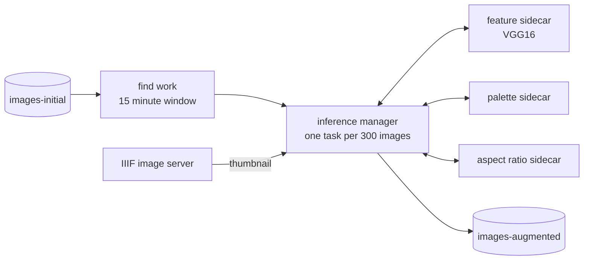
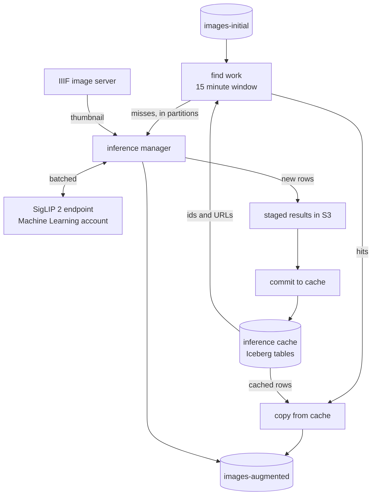

# RFC 095: Image embeddings from a shared endpoint, with caching

## Purpose

The image pipeline computes a feature vector for every image with a VGG16 model that runs in a sidecar next to the inference manager. We want to replace those vectors with SigLIP 2 embeddings, and the Data Science team has offered to host the model on a GPU endpoint in their AWS account. This RFC proposes how the inference manager calls that endpoint across accounts, what it does when the endpoint is unavailable, and how it caches everything it infers about an image in Iceberg tables so that an image is downloaded and embedded once per model. The state machine reads the cache once per run and only starts inference tasks for images it has not seen. It also proposes that the inference manager computes palette and aspect ratio itself, which removes the three sidecars and leaves the task with a single container.

**Last modified:** 2026-11-24T17:05:00+00:00

**Status:** Draft. Sections marked _Open_ wait on answers from the Data Science team or on measurements against a test endpoint.

**Related:**

- [RFC 021: Data science in the pipeline](../021-data_science_in_the_pipeline/README.md) is the original inferrer design. It closes by asking whether every image has to be inferred again when a model is retrained. This RFC answers that the vectors do have to be recomputed, and proposes how to do it without tying the recomputation to a pipeline reindex.
- [wellcomecollection/platform#6865](https://github.com/wellcomecollection/platform/issues/6865) is the parent issue. The build is [wellcomecollection/platform#6913](https://github.com/wellcomecollection/platform/issues/6913) and the reindex is [wellcomecollection/platform#6914](https://github.com/wellcomecollection/platform/issues/6914).
- [wellcomecollection/platform#5320](https://github.com/wellcomecollection/platform/issues/5320) is the 2021 proposal for an inference cache, made to avoid repeating inference and image server load when nothing about an image has changed.

## Context

### How images are inferred today

A state machine runs every 15 minutes for each pipeline date. It finds the images in `images-initial` that changed in the window, splits them into partitions of 300 ids, and starts one inference manager task per partition on EC2 spot instances with no GPU. For each image the task downloads the `!400,400` thumbnail from the IIIF image server and calls three sidecars over localhost: features (VGG16, 4,096 dimensions), palette and aspect ratio. It writes the result to `images-augmented`.

The sidecars date from when the inference manager was a Scala service and the models were Python. The manager has since been ported to Python and lives in the `catalogue_graph` project, so the sidecars are now three Python web servers called by a Python program over localhost, with a shared volume for the image files and a health check each. The feature sidecar holds VGG16 in memory and is given more than half of the task's memory.

Nothing records that an image already has inferred data. From reading the code we believe an image is selected again whenever its parent work is merged again, although we have not confirmed this on a live run. A new pipeline date downloads and infers every image from scratch. The collection holds about 127,000 images.

A task is all or nothing. If any image in a partition fails for a reason other than a permanently missing asset, the task fails and writes nothing. The state machine runs every partition before it fails, so a replay covers only the failed partitions, but nothing replays a failed window automatically.

### The model

The November 2026 hackday and the evaluation that followed used `google/siglip2-base-patch16-224`. It produces 768 dimensions against VGG16's 4,096, it is Apache 2.0 licensed, and its text tower would allow text-to-image search later. We hold reference vectors from this model for 126,826 images.

The checkpoint's reference preprocessing resizes the image straight to 224 by 224 with bilinear interpolation and no crop or padding, rescales by 1/255, and normalises with a mean and standard deviation of 0.5. The reference code does not L2-normalise the output. Our index mapping uses `dot_product`, which requires unit-length vectors.

### The Data Science endpoint

The Data Science team serves a text embedding model from a SageMaker GPU endpoint running Triton Inference Server behind a Ray Serve wrapper, with the model exported to ONNX. They have proposed hosting SigLIP 2 the same way. Their existing endpoint takes one piece of text per request and returns a bare array of floats, with pooling and normalisation compiled into the model graph. It runs one replica on one GPU and its response carries no model version. An image endpoint does not exist yet.

The endpoint will live in the Machine Learning account, which the Data Science team owns and which is separate from the platform account. That account's only VPC is in eu-west-2, so we assume the endpoint will be deployed there. The pipeline runs in eu-west-1.

## Proposal

### How a run works

The state machine reads the cache once at the start of a run and writes to it once at the end. Inference tasks never touch the cache tables.

1. **Find work** selects the images that changed in the window, as it does today. It then reads the id and URL columns of the cache for the pipeline's model identity and palette encoder version, which is a few megabytes, and splits the images into hits and misses.
2. **Copy from cache** handles the hits. It reads the cached rows, reads the image documents from `images-initial`, and writes augmented documents. Hits are grouped by the table's id bucket, so each copy task reads one slice of the table.
3. **The inference manager** handles the misses, in partitions. It downloads each thumbnail, computes aspect ratio and palette, calls the endpoint, validates the vectors and writes augmented documents. It also writes its new rows to a staging file in S3.
4. **Commit to cache** appends every staged file to the tables in one commit and then deletes the files. It runs whether or not any inference task failed.

Most images selected in a normal run are ones the pipeline has seen before, whose work was merged again. Those runs start few inference tasks or none. Once the cache is full, a new pipeline date is a copy from the cache to Elasticsearch.

A hit contacts neither the image server nor the endpoint, so an endpoint outage only delays images that are new.

### Partition sizes

There are three sizes, and only one of them is fixed by something outside our control.

- The endpoint batch is the number of images in one request. SageMaker's payload and response time limits keep it to about 30 thumbnails.
- A copy task takes all the hits that fall in one id bucket, which in a full reindex is several thousand images. Nothing in that step needs a small partition.
- An inference partition is 300 images today. We think that size reflects a task that discarded everything on one failure and ran a slow model on CPU. Neither holds in this design, so the size becomes configuration. It starts at 300, and the benchmark decides whether a larger value is worth it.

A larger inference partition saves task start-up time. It does not make a batch of misses faster overall, because throughput comes from tasks running side by side and from the endpoint's capacity. Fewer and longer tasks do make it easier to hold a steady request rate against the endpoint.

An inference task stages its rows in chunks as it works, so a task that is interrupted keeps what it has finished, whatever the partition size.

In normal running the misses in a window are few and fit in one partition. The one large batch of misses is the first fill of the cache, which runs as a separate job (see Reindexing).

### A single-container inference manager

The inference manager does all of the work for a miss in one process and the task runs one container. The feature adapter in `catalogue_graph/src/inferrer/adapters.py` becomes a client for the endpoint. The palette encoder and the aspect ratio calculation move into the same package as functions. Thumbnails are held in memory, because no other container needs to read them from a shared volume.

Moving the palette encoder needs care, because the sidecar does more than its name suggests.

- It resizes the image to 100 pixels with bilinear interpolation and then to 50 pixels with nearest-neighbour sampling before encoding. The port has to do the same for the output to match.
- It runs the encoding in separate processes through joblib, with its own CPU share. In the manager it should run in a process pool, because the encoding is CPU-bound and would otherwise compete with the download threads and the task heartbeat.
- It pins numpy 1.26 and an old joblib. `catalogue_graph` is on numpy 2 and Python 3.12, so the port needs a parity test against the sidecar's output for a fixed random seed.
- A sidecar that runs out of memory is restarted while the manager retries. In one process the same fault ends the task. With thumbnails of at most 400 pixels I think this is acceptable, and the benchmark below should confirm the memory needed.

`catalogue_graph` already depends on numpy and gains Pillow.

With no model in the task, its memory need falls well below today's allocation, most of which goes to VGG16. I think the task can then move from the EC2 spot capacity provider to Fargate, which would remove the autoscaling group and its machine image from the pipeline. This depends on a benchmark of the in-process palette work that has not been run, and it is a separate change from this RFC.

### Endpoint contract

The full list of what we need from the endpoint, with the reason for each item and what we do if it is not met, is in [Requirements for the image embedding endpoint](endpoint-requirements.md). This section summarises the contract.

We ask the endpoint to accept JPEG bytes in batches and to own decoding, preprocessing and L2 normalisation, so that every caller gets the same vector for the same image.

- Request: _Open_. A batch of JPEG thumbnails, each with an identifier the caller chooses. Thirty thumbnails at our 99th percentile size (75 KB) is about 2.3 MB, which is inside the 6 MB payload ceiling that the stricter AWS documentation gives for `InvokeEndpoint`.
- Response: _Open_. For each item, the caller's identifier, a status, and on success one 768-dimension unit-length float32 vector. The response also reports the model version.
- Per-item status matters because one image the endpoint cannot decode must not fail the other 29. The manager skips an image the endpoint rejects, counts it and raises the same alarm as for a thumbnail that cannot be downloaded. If the endpoint cannot report per-item status, the client splits a failed batch in half and retries until it isolates the image.
- The echoed identifier lets the client detect a response whose items are out of order, which would otherwise store valid vectors against the wrong images.
- Decoding: the endpoint converts every image to RGB (thumbnails can be greyscale or CMYK) and applies EXIF orientation. _Open_: confirm with the Data Science team.
- Preprocessing: the checkpoint's own configuration, described above. A path reused from CLIP would produce different vectors.
- Timing: SageMaker requires the container to respond within 60 seconds, which bounds the batch size.

The manager checks every vector before using it. The vector must have 768 dimensions, contain only finite values, and have a norm within a small tolerance of 1, after which the manager normalises it again in float32 so that the indexed vector is unit length whatever precision the endpoint computed in. A vector that fails the check is treated as an endpoint failure for that image and is not cached.

### Model identity

The model identity is the checkpoint, its Hugging Face revision, the preprocessing, the export precision (fp32, fp16 or int8) and the version the endpoint reports. It is configuration, set per pipeline date.

Vectors from two model identities must never share an index, because nearest-neighbour search compares them as if they were in the same space. A change of model identity is therefore a new pipeline date and a reindex of images, and never a change to a running pipeline.

This places two requirements on the endpoint.

- A deployed model version does not change in place. A new export or quantisation is a new version, served alongside the old one, for example as a second endpoint or a second variant.
- The old version keeps serving until the pipeline date that uses it is retired.

The manager compares the version in each response with its configuration and fails the run on a mismatch. A mismatch means the endpoint changed underneath a live pipeline, which is an incident for both teams to resolve and should not be handled by updating configuration.

_Open_: whether the response can report a version. If it cannot, the endpoint name stands in for the version, on the understanding that a named endpoint is never redeployed with a different model.

### Cross-account access

We propose a role in the Machine Learning account that allows `sagemaker:InvokeEndpoint` on the image embedding endpoints. The inference manager assumes it and calls the SageMaker runtime API in the endpoint's region. This needs no shared network. I think PrivateLink is not justified here, because the payload is public catalogue thumbnails and a cross-region private path would add infrastructure on both sides.

- The inference manager's task role is named after the pipeline date, so a trust policy that names it would need a change in the Machine Learning account for every new pipeline. The trust policy should instead trust the platform account with a condition on `aws:PrincipalArn` that matches the inference manager role name pattern.
- The task role needs its own statement allowing `sts:AssumeRole` on that role.
- Assuming a role from task-role credentials is role chaining, which AWS caps at one hour. A task can run for up to three hours, so the client uses a credential provider that refreshes.
- The client is built for the endpoint's region, and the task needs outbound access to STS and to the SageMaker runtime in that region. The task already reaches the public image server, so we expect this to work, and it is to be confirmed.
- Where the role is defined, and who reviews changes to it: _Open_.
- Whether the Data Science team prefers a resource policy on the endpoint: _Open_. The resource policy route that AWS documents applies to calls through an inference router, which is a different deployment shape.

### Inference cache

The cache holds everything the pipeline infers about an image, keyed on the canonical image id.

- The canonical id is stable across pipeline dates, because the id minter's registry is reused.
- A lookup by id happens before the download, so a hit saves the image fetch, the palette calculation and the endpoint call.
- The cache lives outside any pipeline date.

It is two Iceberg tables, because their inputs change independently.

| Table | Partitioned by | Columns |
| --- | --- | --- |
| Features | Model identity, then a bucket of the image id | Image id, the 768-dimension vector |
| Image properties | Palette encoder version, then a bucket of the image id | Image id, palette embedding, average colour, aspect ratio |

Each row also records the IIIF URL the thumbnail came from, a SHA-256 hash of the thumbnail bytes, and when it was written. The tables live in the same S3 Tables catalogue the adapters use, which compacts files and expires snapshots for us.

The collection is about 390 MB of features for one model and about 500 MB of image properties, so a whole partition fits in memory. Partitioning by identity means a read only touches the model in use, and an identity that no pipeline date uses can be dropped as a partition. The id buckets let a copy task read a slice of the collection, so that a full reindex is spread over several tasks and a small run reads only the buckets its images fall in.

Find work compares the URL in each image document with the URL in the cache. A different URL is a miss. The hash is not checked on a hit, because checking it would need the download. It is there for the audit described below.

Caching the palette freezes one sample of the encoder's random noise for each image. I think this is an improvement, because an image's palette then stays the same from one reindex to the next.

**Writes.** The inference tasks do not commit to the tables. Twelve tasks committing at once would conflict and retry, which this pipeline has already experienced with the FOLIO adapter. Each task writes its rows to staging files, and one step at the end of the run commits them together as an upsert on image id and identity. Two pipeline dates running at the same moment are at most two writers, which a commit retry handles.

The inference manager writes augmented documents before the commit step runs, so a failed commit loses nothing from the pipeline's output. The staged files stay in S3 and the next run's commit step picks them up. Until then, those images are misses and would be inferred again if selected.

**Repair.** There are three routes.

- A commit that wrote bad rows can be rolled back to the previous snapshot, for as long as that snapshot is retained.
- A forced refresh for named ids deletes their rows, so the next run recomputes them. This is also the route for an image that has been re-digitised.
- A periodic audit compares stored hashes with fresh downloads for a sample of ids, and reports mismatches.

An image whose bytes change under the same id and URL keeps its old rows until one of these catches it. We have not measured how often this happens, and I think it is rare enough for the refresh and the audit to cover.

Because the cache is a table, the audit, the comparison with our reference vectors and any reuse of the embeddings by other teams are queries, and need no access to the pipeline.

Find work publishes the number of hits and misses for each run. A sudden fall in the hit rate means the cache is not being read as expected, and should raise an alarm.

### What a run does when the endpoint is cold, slow or down

A remote endpoint adds failure modes that a local sidecar does not have.

- A real-time endpoint that has scaled to zero returns errors for several minutes while an instance starts, and it does not queue requests.
- Container errors arrive as `ModelError` with the container's status code. Service unavailability arrives as a 503 that AWS says to retry.
- The endpoint can throttle us. A reindex with 12 tasks against a single GPU replica is where that would appear.

The proposal is as follows.

- The client retries throttling and unavailability with exponential backoff and jitter, and limits how many requests a task has in flight. The task sends a heartbeat every 60 seconds inside a three-hour limit, so a retry window of several minutes is compatible with the state machine.
- Hits are copied from the cache in their own step, so they are written whatever happens to the endpoint.
- An inference task writes augmented documents and staged rows for every image it completed before it reports the outcome. Today one failed image discards the partition.
- If any image could not be embedded after retries, the task then fails. The commit step still runs, the execution fails and alarms as it does today, and a replay of the failed partition finds everything that succeeded in the cache.

_Open_: whether the endpoint stays warm, and if it scales to zero, whether it uses inference components (which AWS requires for scaling a real-time endpoint to zero). This sets the length of the retry window.

_Open_: replaying a failed window is manual today. An automatic replay would help this design and the existing pipeline, and is not part of this RFC.

### Reindexing

A reindex with a model identity that is already cached makes no calls to the endpoint or the image server. Find work finds every image in the cache, and the copy tasks read the tables one bucket at a time and write about 127,000 augmented documents.

The first reindex with SigLIP 2, and any later change of model, would otherwise send the whole collection to the endpoint from inside the pipeline, at reindex concurrency, with every partition depending on the endpoint. We propose to fill the cache first. A one-off job runs the same download, palette and embedding code over every image id, at a rate agreed with the Data Science team, and commits to the tables in large batches as a single writer. The reindex then finds every image in the cache. Filling the cache can be paused, resumed and repeated without touching a pipeline.

### Migration and rollback

Changes to the inference manager deploy to every live pipeline date, so the manager has to support the old and the new behaviour from one codebase while two dates run side by side.

- The feature source (sidecar or endpoint), the vector size, the model identity and whether the state machine uses the cache are configuration for each pipeline date. The state machine is built from a shared module, so the new steps have to be optional in it. The fixed `FEATURE_VECTOR_SIZE = 4096` becomes part of that configuration.
- The current pipeline date keeps its three sidecars and VGG16 vectors until it is retired.
- The new pipeline date runs the single-container task, with a new images index mapping for 768 dimensions.
- Rollback before the old date is retired is the usual switch back to it. After that, rollback means a fix forward, because the sidecars and VGG16 are gone.
- The `pipeline/inferrer` projects, their container images and their build and deploy steps are removed once no pipeline date uses them.

Moving palette and aspect ratio into the manager can be developed before the endpoint exists, behind the same per-date configuration.

### Query-time text embedding

This RFC covers image embeddings. The same endpoint could embed search queries with the model's text tower later, and nothing here should prevent that. Two points bear on it. An asynchronous SageMaker endpoint accepts only asynchronous calls, so it could not also serve queries, and the text tower needs lowercased input truncated to 64 tokens.

## Alternatives considered

The proposal makes two separate choices: where the model runs, and whether the task keeps its sidecars. The cache is worth building whichever way those go.

### Run SigLIP 2 ourselves, inside the inference manager

The manager loads an ONNX export of the model and embeds images on CPU, in the single container. There is no cross-account dependency, no second team to coordinate with, and no question of endpoint availability. Once the cache is full, the model only has to embed new images, which is a small load.

The only timings we have are from a laptop, where the model embedded 127 images a second against VGG16's 94. We have not measured it on the instance types the pipeline uses. Filling the cache on the current CPU fleet is estimated at three to four hours.

The case for the endpoint does not rest on throughput. One hosted model would serve other teams at Wellcome, and it would be available to embed search queries at request time, which a batch task cannot do. If neither of those matters to us, this alternative is simpler and I think it should be chosen.

_Open_: this comparison needs the endpoint's cost, and who pays it.

### Run SigLIP 2 in our own sidecar

We replace the model in the feature sidecar and keep the sidecar architecture. This is the smallest change to the code, and it keeps the three containers, the shared volume and the EC2 fleet.

### A sidecar that calls the endpoint

We keep the three sidecars and replace the feature sidecar with a small container that calls the endpoint, with or without the cache inside it. The manager would change very little, and the choice between the endpoint and a locally hosted model would be a container image for each pipeline date.

The sidecar contract passes one file path per request. A sidecar cannot see the image id or the partition, so it could not key the cache on the id, batching would need a queue, and the manager would still need changes to write partial results. It also keeps a container, a port, a health check and a build pipeline for what is a network call.

### Keep the cache as S3 objects or in DynamoDB

Both are key-value stores that every inference task would read and write directly, which leaves the state machine as it is today.

- With an S3 object per image, a partition of 300 images is 600 reads, which takes about a second in parallel. S3 has no batch read and no query, so the audit and the fill job have to list keys.
- DynamoDB reads 100 items per call and handles concurrent writers, at the cost of a new table.

Either would be quicker to build. We prefer the tables because a single reader and a single writer per run is simpler to reason about than twelve tasks doing point lookups, most runs then need no inference task at all, a bad write can be rolled back by snapshot, and the embeddings become a dataset that can be queried. The tables could also be built later from S3 objects if we needed to ship sooner.

### Use Iceberg, with each task reading and committing

This keeps the state machine unchanged and uses the tables as a key-value store. A point lookup of 300 random ids cannot skip any files, so each task would read the whole partition to use a small part of it, and concurrent commits from parallel tasks would conflict.

### Key the cache on a hash of the image bytes

A hash of the thumbnail would catch a changed image without anyone noticing it. It needs the download on every run to compute the key, so a reindex would still fetch every thumbnail, and it depends on the image server returning identical bytes for the same request over months. We have confirmed that across minutes only. The proposal stores the hash for auditing and does not use it as the key.

### No cache

We keep downloading and embedding on every merge and every new pipeline date. This is the current behaviour. It makes each reindex depend on the endpoint for the whole collection.

## Impact

- The image pipeline gains a runtime dependency on a service another team operates, in another account and, we assume, another region. The cache limits that dependency to images the pipeline has not seen before.
- The Data Science team takes on two commitments: a model version never changes in place, and an old version keeps serving until we retire the pipeline date that uses it.
- The three sidecars, their container images and their build and deploy steps are removed once the last pipeline date that uses them is retired. The inference manager takes on Pillow as a dependency.
- The image inferrer state machine gains three steps: the split in find work, the copy from cache and the commit. Most scheduled runs start no inference task.
- The inference cache is two new Iceberg tables that outlive pipeline dates and need an owner, retention settings and access for the pipeline's roles.
- The inference task needs less memory, and may be able to move to Fargate once the palette work has been benchmarked.
- There is no locally hosted model to fall back to.
- With a full cache, a new pipeline date contacts neither the image server nor the endpoint.
- An image's palette no longer changes between reindexes.
- An image whose bytes change under the same id and URL keeps its old inferred data until someone refreshes it or the audit finds it.
- `vectorValues.features` changes from 4,096 to 768 dimensions, which needs a new index mapping and a reindex ([wellcomecollection/platform#6914](https://github.com/wellcomecollection/platform/issues/6914)).
- _Open_: who pays for the endpoint, and what availability it is run to.

## Open questions

For the Data Science team:

1. The region and account of the endpoint.
2. Whether it is always on or scales to zero, and whether it uses inference components.
3. Whether it accepts batched JPEG bytes, with per-item status and a caller-supplied identifier echoed for each item.
4. Whether it owns decoding (RGB conversion, EXIF orientation), preprocessing and L2 normalisation.
5. Whether the response can report a model version, and the export precision.
6. Whether a model version can be immutable once deployed, with an old version kept serving until we retire the pipeline that uses it.
7. The authorisation route they will support.
8. Expected throughput, and the rate we should stay under while filling the cache.
9. Who we tell when it is down, and the availability to design for.

To measure:

- Cosine similarity and overlap of the ten nearest neighbours between the endpoint's vectors and our reference vectors, on a few thousand images. This tells us how far ONNX export and any quantisation move the vectors.
- Throughput and error behaviour with 12 concurrent tasks, including throttling.
- Cold-start time, if the endpoint scales to zero.
- CPU time and peak memory of the palette encoding inside the manager, for partitions of 300 and of 2,000 images. This sizes the task and sets the inference partition size.
- Time and memory for find work to read the id and URL columns, and for a copy task to read one bucket and write its documents. This decides whether the copy runs as a Lambda or as a task, and how many buckets to use.
- How often thumbnail bytes change under the same URL, sampled over several weeks and bypassing the CDN cache.
- Whether merging a work again selects its unchanged images for inference, observed on a live run.

## Next steps

1. Get answers to the questions above and fill in the open sections.
2. Run the measurements that need a test endpoint, and the ones that do not.
3. Review this RFC with the Data Science team.
4. Move palette and aspect ratio into the inference manager. This does not depend on the endpoint. It is outside the scope of the current build issue and needs an issue of its own.
5. Build the endpoint client, the cache tables, the state machine steps and the per-date configuration ([wellcomecollection/platform#6913](https://github.com/wellcomecollection/platform/issues/6913)). The state machine changes make this larger than that issue's current estimate.
6. Build the job that fills the cache, and the forced refresh and audit tools. These also need an issue.
7. Fill the cache, then reindex with SigLIP 2 vectors and switch production ([wellcomecollection/platform#6914](https://github.com/wellcomecollection/platform/issues/6914)).
8. Retire the sidecars with the last pipeline date that uses them.
